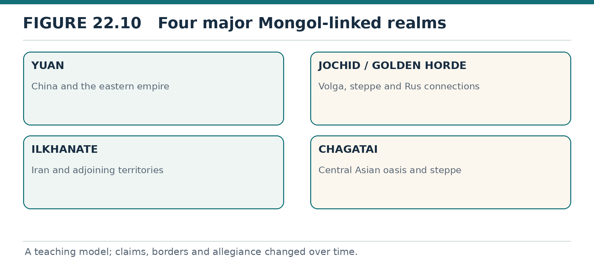

До по-късно тринадесети век историците често описват четири основни монголски енергийни центрове: династията Юан, Илханат, Чагатай ханате и Йочид/Златна орда. Това е полезна схема за организиране, а не карта на четири перфектно разделени кутии. Техните граници се движели, техните управници се борили, междуженявали се или преговаряли и много регионални групи имали степени на автономия. Части от Индия, Япония, Югоизточна Азия и Близкия изток останаха извън прекия монголски контрол въпреки нашественическите заплахи или дипломатическите отношения.

Всяка сфера се развива по различен начин, защото управлява различни екологични и социални условия. Императорът на Юан зависеше от китайското селскостопанско облагане и митрополитската администрация; Йохид Хан преговаряше с принцове и градове в цяла степ и Източна Европа; Илхан работеше с персийски фискални служители и местни земевладелци; владетелите на Чагатай управляваха през оазисни селища и пасторални зони. Една монголска традиция не произвела една универсална политика. Дори езикът на империята може да скрие различията между притежанието, почитта, династичните претенции и способността за налагане на решения.

Тази дивергенция прави по-късния монголски свят по-интересен от история за възход и падане. Някои наследници на династии запазват търговски връзки, докато се бият помежду си. Някои приели исляма или все по - покровителствали будистките традиции. Други възприеха различни литературни езици и съдебни ритуали. Оригиналната семейна връзка оставала политически значима, но не гарантирала хармония. Фразата Пакс Монголица е полезна само ако искаме мир за кого, по кой път и през кои десетилетия?

<figure class="figure" id="figure-22-10">

<figcaption>Фигура 22.10. Ученически модел; претенции, граници и вярност се променили с течение на времето. <a class="figure-anchor" href="#figure-22-10" aria-label="Link to this figure">#</a></figcaption>
</figure>
