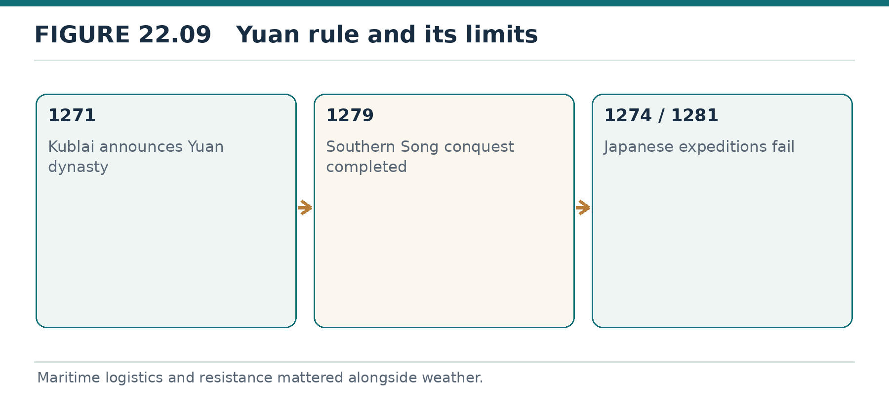

Борбата след смъртта на Мьонгке през 1259 г. разкри голяма фрактура. Неговите братя Kublai и Ariq Böke се състезаваха за върховната власт; Kublai надделя след гражданска война, но идеята за един голям хан командир на всеки монголски свят е все по-нереалистично. Кубилай управлявал от китайския политически свят и обявявал династията Юан през 1271 г. Монголците завършиха завладяването на Южната песен до 1279 г., което доведе целия Китай под управлението на Юан. Династичната столица в Даду (модерен Пекин) се превръща в център на империя, съчетаваща степ и китайски институции.

Правителството на Юан се възползва от китайската бюрократична практика, запазвайки значителни различия в етническия и статута. Разделянето на обществото в класирани категории не беше перфектно определено във всяка обстановка, но завоеванието оказа влияние върху достъпа до офис, правното положение и привилегиите. Местни служители, администратори от Централна и Западна Азия, търговци и специалисти работиха в правителството. За да опише Юан просто като владетели с монголски имена, липсва отличителната политическа мрежа на императорския двор; за да го опише просто като чуждестранен военен лагер, той пропуска използването на китайските институции.

Амбициите на Кубилай достигнаха и отвъд Китай. Юан и съюзническите сили на Корьо нахлуват в Япония през 1274 и 1281 г., но не осигуряват завоевание. Бурите помогнаха за оформянето на по-късната памет, особено на втората експедиция, но японската отбрана, морската логистика и командните трудности също имаха значение. В Югоизточна Азия Юан провеждаше кампании и дипломация със смесени резултати. Една империя, оптимизирана за континентално движение, не можела да прехвърли силата си без усилие във всяко море.

<figure class="figure" id="figure-22-9">

<figcaption>Фигура 22.9. Морската логистика и съпротивата са от значение заедно с времето. <a class="figure-anchor" href="#figure-22-9" aria-label="Link to this figure">#</a></figcaption>
</figure>
