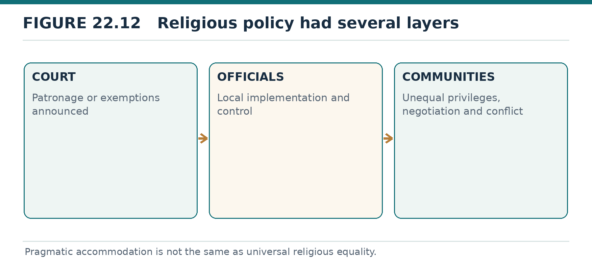

Империята управлявала будисти, мюсюлмани, християни, даоисти, хора, участващи в различни местни традиции и общности, практикуващи тенгристи или свързани степни религиозни традиции. Монголските владетели можели да покровителстват няколко религиозни институции едновременно и да наемат духовници или специалисти от различни религии. Западните посетители, включително Уилям Рубрук, срещали религиозно разнообразие в монголските съдилища. Някои местни религиозни водачи получиха изключения или привилегии; други изпитаха ограничения, политически конфликти или унищожение, придружаващи военни кампании.

Общото твърдение, че монголците практикували съвършена религиозна толерантност, е твърде широко. По - точно е да се каже, че много владетели приеха прагматично религиозно настаняване, като често използват конкурентни религиозни общности за укрепване на авторитета. Политиките могат да се променят при различни ханове и региони. По-късно ислямското обръщане сред владетелите на Илханат и Златната орда не е изтрило всички предишни вярвания мигновено; то трансформира политическата легитимност и държавните институции с течение на времето. В Китай покровителството на съда и тибетските будистки връзки се развиваха по отличителен начин.

Религиозното разнообразие също разкрива предизвикателството на империята, създадена от различни общества. Мюсюлмански търговец в един град, будистка монашеска общност близо до друга и християнски пратеник в двора може да има различен опит от една и съща династия. Отношението на владетеля не е идентично с всекидневния религиозен живот. Изучаването на империята изисква да разгледаме заедно закона, покровителството, насилието, местната автономия и индивидуалните показания.

<figure class="figure" id="figure-22-12">

<figcaption>Фигура 22.12. Прагматичното настаняване не е същото като всеобщото религиозно равенство. <a class="figure-anchor" href="#figure-22-12" aria-label="Link to this figure">#</a></figcaption>
</figure>
