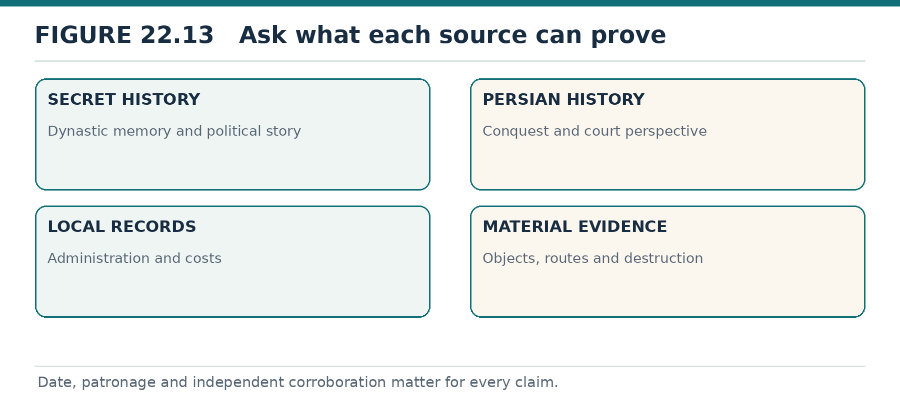

Тайната история на монголците, композирана през тринадесети век и оцеляла чрез сложна ръкописна традиция, е централен източник за възхода на Темюджин. Тя запазва родословието, политическата памет, речите и историите за лична лоялност. Тези черти го правят безценен, но също така ни предупреждават, че текстът служи като династичен разказ. Героична реч, написана в историята, не може автоматично да се опише като точните думи, изречени на бойното поле десетилетия по-рано.

Персийските историци като Ата-Малик Ювайни и Рашид Ал-Дин работили под или близо до монголските правителства. Техните текстове съхраняват информация, която не е достъпна другаде, като същевременно отразяват политическите си позиции, литературните конвенции и източници. Китайските бюрократични сметки, археологическите материали и западните пътни разкази осигуряват допълнителни точки за разглеждане. Нито една традиция не говори за всички народи под монголското управление. Понякога двама автори повтарят една и съща история, защото единият копира другия: споразумението между зависимите източници не е независимо потвърждение.

Прилагане на четири части одит: дата и близост, цел и покровителство, вид претенции, и независима кръстосана проверка. Хроника може да бъде силно доказателство, че владетелят търси легитимност, но слабо доказателство за точния брой убити в далечен град. Данъчният документ може да бъде силно доказателство за оценено задължение, докато ни казва малко за това дали действително е бил събран. Четенето на средновековна история означава да мислиш за доказателства едновременно с разказа, а не след него.

<figure class="figure" id="figure-22-13">

<figcaption>Фигура 22.13. Дата, покровителство и независимо потвърждение за всяко твърдение. <a class="figure-anchor" href="#figure-22-13" aria-label="Link to this figure">#</a></figcaption>
</figure>
