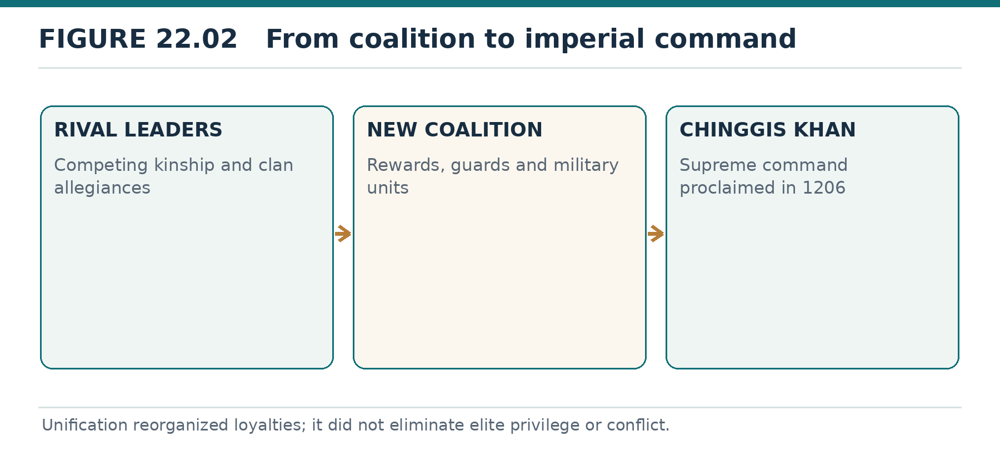

През 1206 г., след като победил важни съперници, Темюджин бил провъзгласен за Чинггис Кхан на събрание или Курилтай. Заглавието, чието точно тълкуване се обсъжда, отбеляза ново политическо твърдение: лидерството не само на група другари, но и на по-широка общност от народи и владетели. Датата е полезна отправна точка за Монголската империя, въпреки че институциите, които я поддържали, еволюирали през следващите десетилетия. Известната фраза "най-голямата близка сухоземна империя" описва императорската система при нейното най-голямо разширяване под неговите наследници, а не територията, която лично завладява през 1206 г.

Имперски иск изисква механизми. Домакинствата и военните групи бяха реорганизирани; избрани мъже сформираха кралска стража; командирите командваха отряди, разположени в конвенционални десетични групи; пратениците изпълняваха заповеди на големи разстояния. По-късно авторите понякога описват един цялостен правен код, наречен Великия Яса. Но оцелелите доказателства не оправдават въображението на съвременна книга, съдържаща всяко предполагаемо монголско управление. Кралските заповеди, обичаи и по-късни спомени са събрани заедно по начин, който учените продължават да разследват.

Новият ред съчетаваше интимна лоялност с огромна принуда. Завладяваните народи могат да доставят войни, занаятчии, животни, данъчни приходи и логистични услуги. Успешните командири могат да станат силни чрез служба, но богатството и рангът остават политически оспорени. Институционалното изграждане не направи империята мирна. Тя направи възможно организираното разширяване и даде на владетелите методи за насочване на завоеванието към трайните власти, които по-късно ще бъдат адаптирани много различно в Китай, Иран и западната степ.

<figure class="figure" id="figure-22-2">

<figcaption>Фигура 22.2. Обединяването реорганизирало лоялността; то не премахнало елитната привилегия или конфликт. <a class="figure-anchor" href="#figure-22-2" aria-label="Link to this figure">#</a></figcaption>
</figure>
