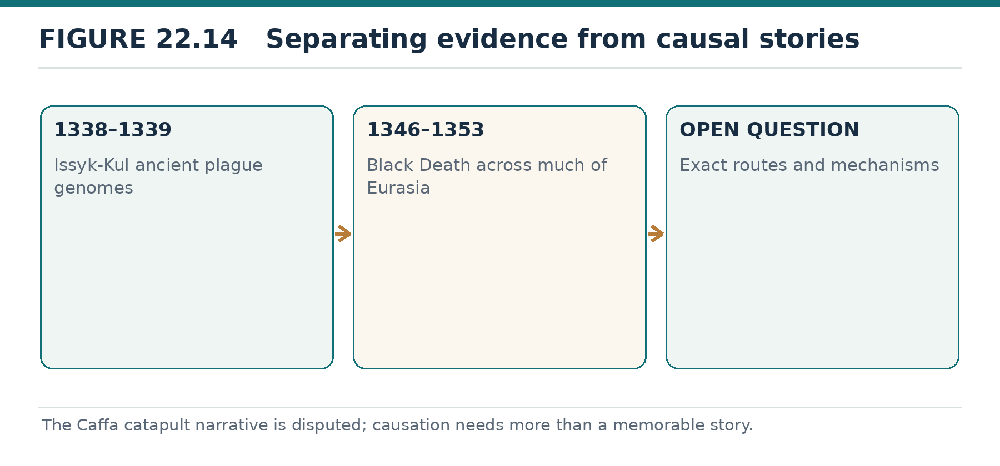

Монголските връзки от разстояние се пресичат с едно от най-големите демографски бедствия в историята. Черната смърт достига голяма част от Европа, Близкия изток и Северна Африка в средата на ХVІХ век, докато по-ранни епидемии са настъпили другаде. Болестта включваше Yersinia pestis, бактерия с екологични резервоари и пътища, които все още са проучени. A 2022 древен ДНК проучване намери доказателства чума на гробища близо до езерото Issyk-Kul в днес Киргизия датират от 1338 год., предоставяне на важни доказателства за произход на щамове, свързани с по-късната пандемия.

Изкушаващо е да се нарисува проста стрела, свързана с Монголс Евразия, поради което монголите причинили Черната смърт. Изявлението преувеличава. Политическите връзки, движението на хора и стоки, екологичните условия и маршрутите за предаване на болести са свързани, но детайлите се различават в различните места. Оспорваните по-стари разкази описват заразени с чума трупове, които биват катапултирани в селището на Генуа в Кафа. Известната история разчита силно на неочевидна акаунт и не е сигурно обяснение за разпространението на пандемията. Историците са показали, че търговията в Черно море, ембаргото и хронологията правят простата история неадекватна.

<strong>Връзката създава рискове, както и ползи.</strong> Пътищата и пристанищата не избират да предават ръкописи вместо патогени. Аналитичната задача е да се реконструират механизми, вместо да се твърди, че една империя е създала природно бедствие. Дори и там, където остават дебатите за причинно-следствената връзка, катастрофата ни напомня, че историческото значение на обменната мрежа зависи от това какво се движи през нея.

<figure class="figure" id="figure-22-14">

<figcaption>Фигура 22.14. Разказът за Каффа катапулта се оспорва; причинно-следствената връзка се нуждае от нещо повече от незабравима история. <a class="figure-anchor" href="#figure-22-14" aria-label="Link to this figure">#</a></figcaption>
</figure>
