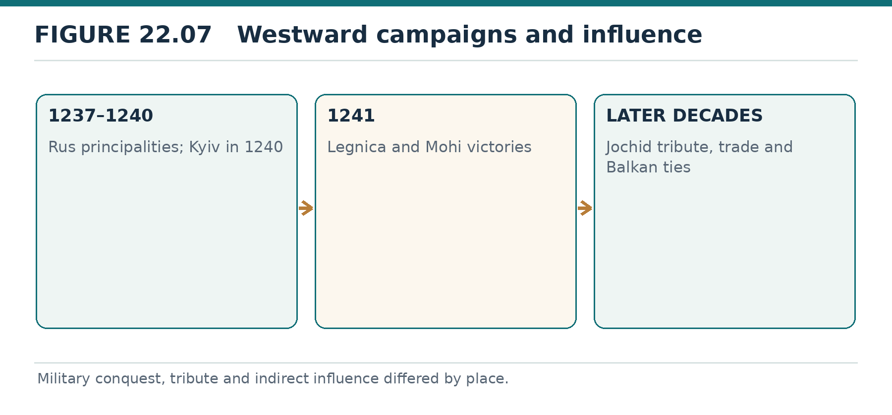

Монголските сили напредваха срещу Волга Булгарс и руските княжества по време на кампаниите, свързани с Бату, потомък на Йочи и командира Сюбедей. Те пленили или унищожили много градове и победили разделените князски армии; Киев паднал през 1240 г. Кампанията не беше срещу единна национална държава, наречена Русия, която не съществуваше в съвременната си форма. Обществата и управниците на Рус имали различни интереси, а отношенията им с новата монголска сила продължавали да се развиват.

През 1241 г. монголските армии побеждават войските си в Легница в Полша и Мохи в Унгария. Западният напредък предизвика страх в цяла Европа. Кампанията се оттегли от Унгария през 1242 г., но обяснението е оспорено. Смъртта на Йогей през декември 1241 г. и политиката за наследяване са от значение, но историците също проучват местната съпротива, терена, доставките, времето и по-широките стратегически цели. Твърде просто е да се каже, че една смърт автоматично спаси Европа. Нито пък е вярно, че монголците са били технологично неспособни да се движат из Европа; те вече са демонстрирали опасен оперативен обхват.

За Югоизточна Европа ефектите достигат отвъд бойните полета. Монголските експедиции и по-късно западната степна политика влияят на Втората българска империя и съседните поляти чрез набези, почитен натиск, дипломация и силата на лидери като Ногай. Точната хронология и степента на зависимост варираха. Би било подвеждащо да си представим една неизменна монголска администрация, която управлява всяко балканско село. Опитът на региона показва как би изглеждало императорското влияние без единна директна окупация.

<figure class="figure" id="figure-22-7">

<figcaption>Фигура 22.7. Военното завоевание, почитта и непрякото влияние се различават по мястото. <a class="figure-anchor" href="#figure-22-7" aria-label="Link to this figure">#</a></figcaption>
</figure>
