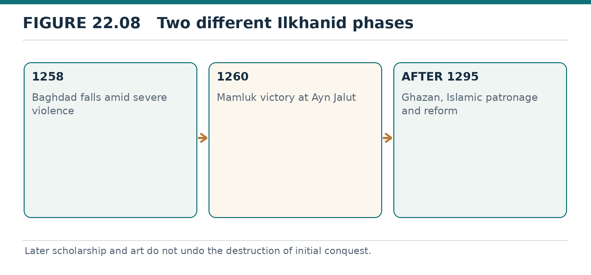

Под Möngke Khan, които станаха големи хан през 1251, бяха организирани нови кампании в различни фронтове. Брат му Хюлегю напреднал на запад, преодолявайки големите крепости на Низари Исмаили и придвижвайки се срещу Абасидския халифат. През 1258 г. монголските сили обсадили и пленили Багдад. Градът е претърпял насилие и разрушение; Абасидският халиф е бил убит, слагайки край на Багдадския Аббасидски халифат като управляваща институция. Популярните предсказания разказват за книги, които превръщат Тигъра в черен с мастило. Такива изображения улавят катастрофа, но не бива да се бъркат с измерен, независимо проверен разказ за съдбата на всяка библиотека.

Наследниците на Хюлегю създадоха Илханат, център в Иран и съседните региони. Неговите управници разчитали силно на персийски служители, местни данъчни системи и квалифицирани градски общности. Контролът не беше еднакъв, а отношенията със Златната орда и Мамлук Египет предизвикаха повтарящ се конфликт. Монголският авангард в Сирия се сблъскал с решаващо поражение от страна на мамлюците при Айн Джалут през 1260 г. Тази битка не елиминира монголската власт в Иран; тя показа, че може да се окаже съпротива на по-нататъшното разширяване и че регионалните войни имат свои политически и логистични ограничения.

Към края на тринадесети век владетелите на Илханид възприели и покровителствали традиции, вкоренени в обществата, които управлявали. Гхазан, който дойде на власт през 1295 г., се превърна в ислям и въведе важни реформи. Дворното изкуство и писането на история процъфтяват; илюстрираните хроники на Рашид ал-Дин са сред най-значимите културни продукти в периода. По този начин същата династия била едновременно агент на завоеванието и участник в персийската и ислямската цивилизация. Наричайки го или изцяло извънземна окупация, или несложно културно възраждане ще прикрие съществени доказателства.

<figure class="figure" id="figure-22-8">

<figcaption>Фигура 22.8. По-късно стипендията и изкуството не премахват унищожението на първоначалното завоевание. <a class="figure-anchor" href="#figure-22-8" aria-label="Link to this figure">#</a></figcaption>
</figure>
