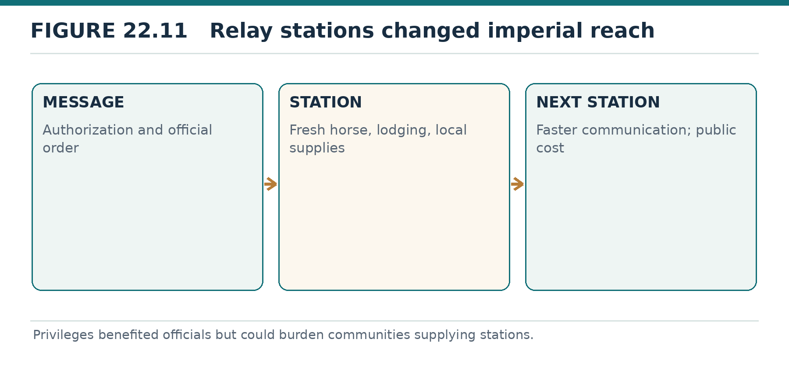

Владетелите на разпръснати територии са изправени пред централен проблем: поръчките са безполезни, ако пристигнат след като събитията са се променили. Монголската държава разработва и разширява мрежа от реле-пост, която обикновено се нарича картоф или конфитюр, с станции, подкрепящи упълномощените посланици. Конете, провизиите и настаняването могат да направят комуникацията по-бърза на дълги разстояния. Разрешителните за пътуване, понякога представени с таблети или документи, известни като Пайза, помогнали да се идентифицират хората, които имат право да използват императорски съоръжения. В някои региони тези договорености се основават на по-стари практики, вместо да се появяват от нищо.

Релената мрежа не беше публична пощенска услуга, отворена свободно за всички. Тя наложи разходи на общностите, необходими за предоставяне на животни и доставки, и системата може да бъде малтретирана от елити. Фактът, че едно дипломатическо послание може бързо да се движи, ни говори малко за това дали един обикновен селянин е получил същата защита. Понякога служителите и търговците се възползвали от по - предсказуеми пътища, но войната, кражбата и местната власт все още ограничавали пътуващите. Системите се различават в различните ханати и поколения.

Хипотетичното изчисление илюстрира потенциалната разлика. Ако куриер може да сменя коне и средно 120 километра на ден, маршрутът за съобщение с 1200 километра ще отнеме 10 дни. Индивидуално парти средно 40 км на ден ще се нуждае от 30 дни, с изключение на спирки. Това са предположения за преподаване, а не исторически средни резултати. Урокът е за това как инфраструктурата превръща публичните ресурси в административни средства и защо ползите и тежестите са разпределени неравномерно.

<figure class="figure" id="figure-22-11">

<figcaption>Фигура 22.11. Правата са били от полза за длъжностните лица, но биха могли да обременяват общностите, доставящи станции. <a class="figure-anchor" href="#figure-22-11" aria-label="Link to this figure">#</a></figcaption>
</figure>
