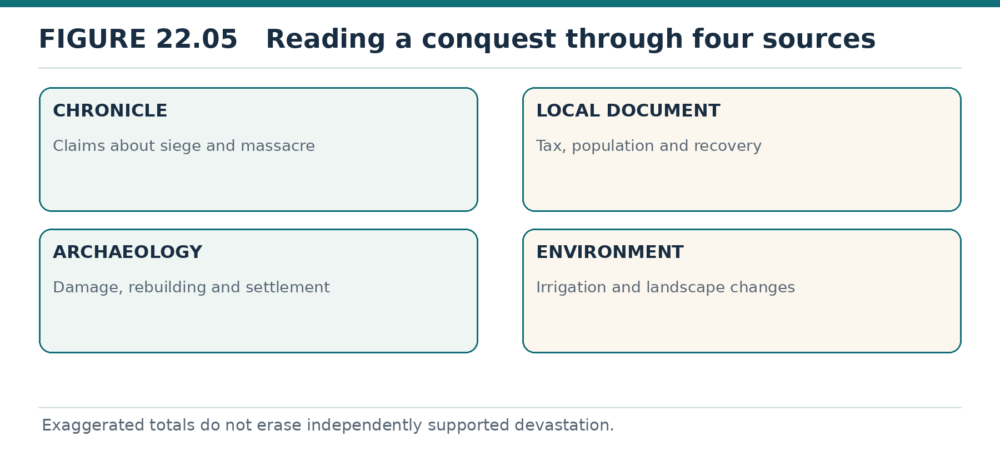

Куаразмската империя контролирала голяма част от Централна Азия и Иран, когато монголците приближавали границите си. Търговци, пратеници и владетели са действали в деликатно пространство, където търговията и дипломацията се припокриват. Сметките често свързват войната с конфискуването или убийството на монголска търговска каравана в Отрар и последващото лошо отношение към пратениците. Епизодът имаше значение, но източниците се различават по детайлите и отговорността; инвазията също се случи в контекста на разширяващата се имперска стратегия.

Започвайки през 1219 г., монголските армии атакували кхваразмското царство. Градове, включително Бухара и Самарканд паднаха; кампании и обсади опустошени селища в целия регион. Една по - късна фаза включваше кампании в Кхурасан и другаде, докато преследването на армии напредваше удивително на запад. Хроничарите записват масово клане, принудително преместване, унищожаване на инфраструктурата и загуба на градско население. Някои разкази дават огромни суми на смъртните случаи, които не могат да бъдат третирани като надеждни. Неясните числа не правят страданието въображаемо: повтаряйки се, независими доказателства показват, че завоеванието е било дълбоко разрушително.

Защо градовете били уязвими? Политическото разделение, съперниците командири, трудните комуникации и монголската оперативна координация имат значение заедно със стените и силата на войските. Но един победен град не винаги е изпитвал една и съща съдба: изборът за съпротива, преговори, местни лидери и командири цели засегнати резултати. Историята не се обслужва добре от една формула, която казва, че монголците винаги избивали противници или винаги пощаждали онези, които се предавали. Общата заплаха от насилие беше реална, но събитията варираха. Преобразуването на тези градове осигурява решаващо противотежест на по-късните истории за процъфтяващата Евразийска търговия.

<figure class="figure" id="figure-22-5">

<figcaption>Фигура 22.5. Преувеличените суми не изтриват самостоятелно подкрепяното опустошение. <a class="figure-anchor" href="#figure-22-5" aria-label="Link to this figure">#</a></figcaption>
</figure>
