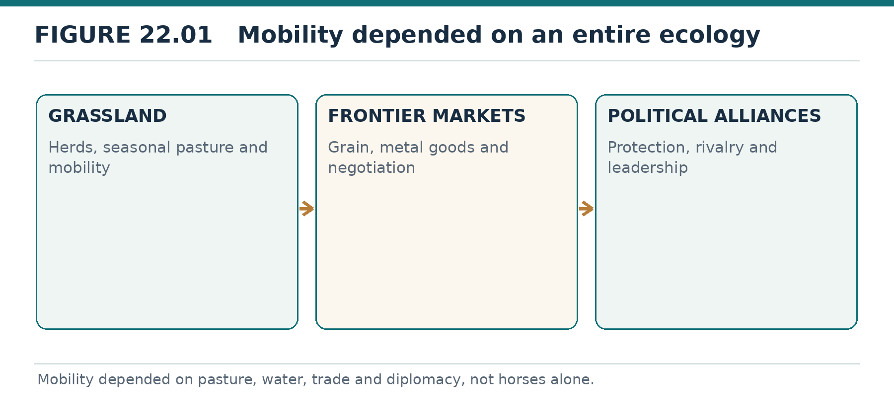

Източна Евразийска степ включва големи тревни площи, планински ръбове, реки и зони, граничещи с гори и пустини. Много домакинства практикуваха пасторализъм, в зависимост от стадата за храна, материали, транспорт и обмен. Движението между сезонните пасища беше форма на екологично познание, а не доказателство, че на хората им липсваха установени институции или културен живот. Конете имали значение, защото предлагали скорост и издръжливост през пейзажите, където каруците, пехотинците и селскостопанските армии се сблъсквали с тежки ограничения. Въпреки това хората също така се нуждаят от надежден достъп до вода, фураж, политически съюзници и пазари за стоки, които не са произвеждали сами.

Степ не беше една нация. Около младостта на Темюджин, различни общности, включително Монгол, Кереит, Найман, Меркит и Татарски групи, формирали разместването на съюзите и се борили за пасищна земя, пленници, престиж и търговия. Някои от тях са свързани с държави като династията Jurchen-led Jin в Северен Китай. Местните управници могат да възнаградят съюзнически степ лидери, да ограничат търговията или да подкрепят съперници. Границата между номадски и установени общества следователно е област на преговори, а не не непресичаема стена. Монголски владетел може да зависи от китайски пазар за метални стоки, точно както Граничното правителство може да разчита на степи коне.

Карта, която оцветява степта като празна, маскира гъстата си политическа география. Зимните условия могат да заплашат стадата; сушата може да създаде конкуренция; брачните съюзи могат да решат дали едно семейство ще оцелее. Мобилността беше предимство, а не безгранична свобода. Ако една армия загуби достъп до пасища или се натъкне на укрепени стени и лоша логистика, монтирани умения сами по себе си не може да осигури победа. Имайте предвид този баланс, когато се сблъскваме с известни конни кампании: техният успех включваше организация и знания колкото коне.

<figure class="figure" id="figure-22-1">

<figcaption>Фигура 22.1. Мобилността зависила от пасищата, водата, търговията и дипломацията, а не само от конете. <a class="figure-anchor" href="#figure-22-1" aria-label="Link to this figure">#</a></figcaption>
</figure>
