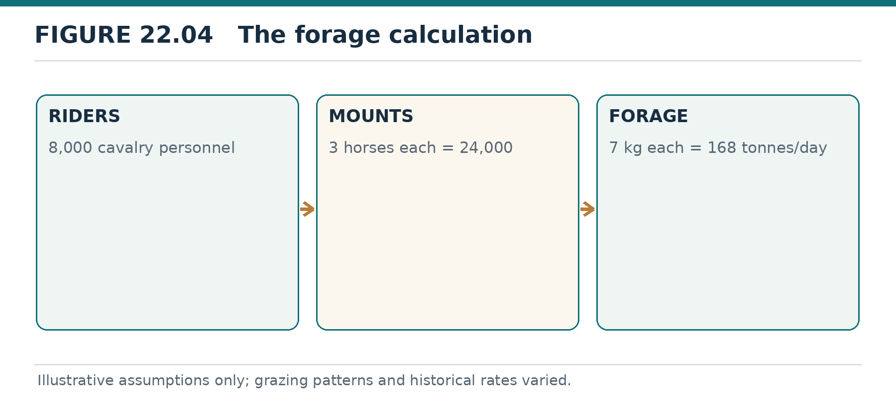

Една предизборна сила изисквала много повече от смелост. Конете се нуждаят от пасища или храна, мъжете се нуждаят от храна и вода, а армията трябва да носи оборудване, като избягва изтощението. Един конен отряд, който пътувал из пасищата, можел да получи някои ресурси на местно ниво; същата единица през зимата, опустошена долина, претъпкан маршрут или близо до укрепен град може да се бори. Лагери, стада, разузнавачи, семейства, пленници и специалисти не всички пътували с една скорост. Командирите трябваше да планират кой се е преместил, къде са намерени доставките и когато подходът стана неустойчив.

Да разгледаме един хипотетичен аритметичен пример, а не реконструкция на определена монголска армия. Да предположим, че 8000 ездачи имат по три коня. Това са 24 000 коня. Ако всеки кон изисква средно по 7 килограма ядлива фураж на ден, животните заедно се нуждаят от 168 000 килограма метрични тона дневно. Действителните изисквания и приемът на пасища са различни, а тревопасните животни не носят задължително този фураж като опакован товар. Въпреки това упражнението разкрива защо изборът на маршрути, сезоните, състоянието на животните и разпръснатите движения са от значение. Числата превръщат неясна дума като логистиката във физическо ограничение.

Второто ограничение беше информация. Един владетел, който знае местоположението на реките и пътищата, но не и политиката на следващия град, може да загуби войски в обсада. Монголските сили събраха сведения от търговци, предадоха се длъжностни лица и пратеници. Те биха могли да настояват за представяне предварително, застрашавайки ужасни последици за съпротивата. Такива заплахи бяха инструменти на война и политическо господство, а не неутрална комуникация. Стратегическата ефективност и умишлен терор съществуваха заедно. Разбирането на механизма не оправдава страданията, които е причинил.

<figure class="figure" id="figure-22-4">

<figcaption>Фигура 22.4. Само илюстративни предположения; моделите на паша и историческите цени варират. <a class="figure-anchor" href="#figure-22-4" aria-label="Link to this figure">#</a></figcaption>
</figure>
