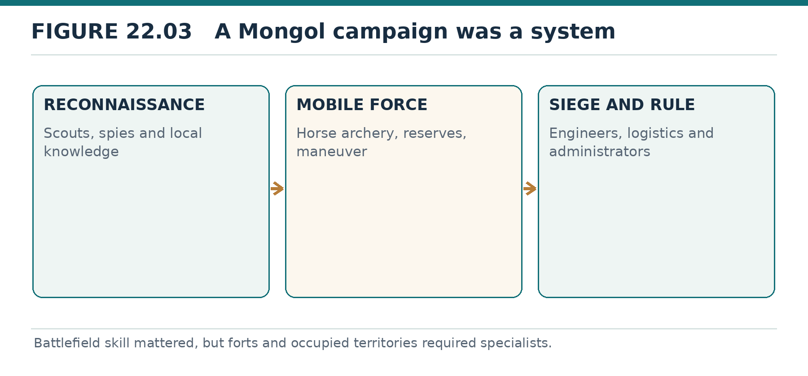

Популярният образ е на кон стрелец състезател през открити пасища. Планинската стрелба с лък била от решаващо значение, особено когато ездачите можели да избират разстояние, да маневрират около опонентите или да извършат планирано отстъпление. Един боец може да управлява повече от една планина, позволявайки смяна на коня по време на продължително движение. Командирите използваха скаути, разузнаване, координирани крила, измами и кампании, които атакуваха съюзниците или комуникациите на врага. Високата мобилност също така даде възможност на армиите да концентрират сила на избрано място, преди по-бавен противник може да реагира.

Но монголската военна система била по-разнообразна от кавалерийски стереотип. Тя абсорбира инженери, обсадни екипи, пехота, местни водачи и специалисти от завладените общества. Срещу крепости армиите могат да построят обсадни съоръжения, блокират пътища, отклоняват водата или преговарят за капитулация. Срещу морските цели, особено по-късно под управлението на Юан, завоеванието изисквало кораби, моряци и непознат набор от умения. Никоя армия не била непобедима и същата тактика не била еднакво ефективна във всеки терен или политическа среда.

Военните историци различават убедителното обяснение от героичната легенда. Имаме доказателства за съставни лъкове, доспехи, дисциплинирана организация и обсадни технологии. Нямаме надеждна точност за всяка армия с размер или брой жертви в средновековните хроники. Ако източник твърди, че невероятно огромна монтирана сила е преминала през сух регион, попитайте за фураж и вода: конят консумира ресурси всеки ден и голяма армия с множество планини бързо се превръща в движещ се екологичен проблем. Този прост логистичен въпрос често е по-полезен от образа на неспираема орда.

<figure class="figure" id="figure-22-3">

<figcaption>Фигура 22.3. умението на бойното поле имаше значение, но укрепленията и окупираните територии изискваха специалисти. <a class="figure-anchor" href="#figure-22-3" aria-label="Link to this figure">#</a></figcaption>
</figure>
