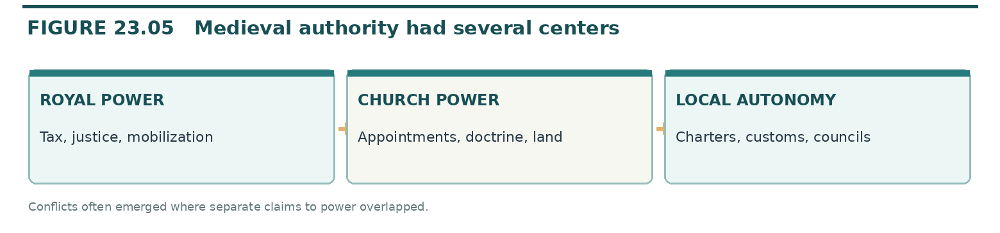

Християнството е структурирало голяма част от средновековния обществен живот, но нито една църква или владетел не е командвала всички християнски общества. В Латинска Европа, епископи, манастири, енорийски общности и папските институции за поклонение, образование, право, благотворителност и собственост. Църковните водачи могат да преговарят с царете за назначаването на епископи, юрисдикция и приходи. Конфликтите, които обикновено се групират по време на спора за инвеститорите, показват, че политическата и религиозната власт са преплетени, но не са идентични. Един владетел потърсил лоялни администратори; реформаторите на църквата твърдяли независимостта и духовните сили на църковните служби.

В Константинопол императорите защитавали и понякога се намесвали в църковните дела, докато патриарси, монашески водачи и епископи притежавали собствена власт. Наричайки Източната църква императорски отдел би бил неточен: неговата теология, канонно право, монашески мрежи и вътрешни спорове биха могли да ограничат императорите, както и да им служат. Нито трябва средновековната латинска църква да бъде описана като чисто духовна организация: притежавала е собственост, управлявала е съдилища и поддържала международни мрежи. Еврейските общности, мюсюлманските институции и религиозните малцинства се сблъскаха с различни правни и социални ситуации в зависимост от града, династията и момента.

Следователно отношенията между църквата и държавата били преговори за персонал, право, собственост и легитимност. Историците трябва да разделят доктрината, политическите претенции, институционалната практика и опита на обикновените вярващи. Един урок за цялата книга е, че средновековната религия не действала само в частния живот; тя помогнала да се определи публичната власт, календарите, образованието, благосъстоянието, груповите граници и основанията, на които владетелите можели да бъдат оспорени.

<figure class="figure" id="figure-23-5">

<figcaption>Фигура 23.5. Конфликтите често се появяват, когато отделни претенции за власт се припокриват. <a class="figure-anchor" href="#figure-23-5" aria-label="Link to this figure">#</a></figcaption>
</figure>
