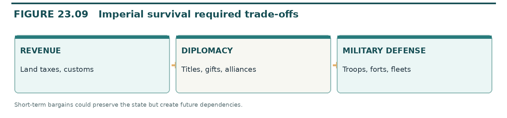

Византийската оцеляване дължи много на институции, способни да събират приходи, оборудване армии и отговор на променящите се граници. Земеделските данъци, митата и съдебните ресурси не са написани от бюрокрацията, дипломацията и военните сили. Войниците могат да бъдат вербувани или подкрепяни чрез различни регионални договорености, а военната организация се променя многократно с течение на времето. Терминът тема често се използва за провинциални райони и военна организация, но човек не трябва да си представя, че всички теми работят еднакво в продължение на векове. Империята също така наема чуждестранни войски, съюзници и специализирани професионалисти.

Бюрократичните записи, законите и церемониалните текстове разкриват едно правителство, силно засегнато от ранга, задължението и легитимността. Правната приемственост била от значение; императорите се представяли като пазители на една подредена християнска римска общност. Но официалните правила не попречиха на съдебни преврати, аристократична конкуренция или местна съпротива. Провинциален елит натрупва земя и власт, понякога създава напрежение с фискалната основа на държавата. Дипломацията използвала подаръци и титли не защото византийските служители били страхливи, а защото купуването на мир или съюз можело да струва по - малко от воденето на опасна война.

Да разгледаме хипотетична граница. Военният командир иска повече хора; данъчен служител се притеснява, че реквизицията ще изпразни фермите; императорът се страхува, че съседната сила ще се съюзи с вътрешен съперник. Политика, която изглежда слаба на бойната карта може да се окаже рационална, когато хазната, работната сила и политиката се разглеждат заедно. Тази комбинация от сложна администрация и повтаряща се нестабилност е от основно значение за разбирането как империята издържа до 1453 г. и защо понякога понася катастрофални загуби.

<figure class="figure" id="figure-23-9">

<figcaption>Фигура 23.9. Краткосрочните сделки могат да запазят държавата, но създават бъдещи зависимости. <a class="figure-anchor" href="#figure-23-9" aria-label="Link to this figure">#</a></figcaption>
</figure>
