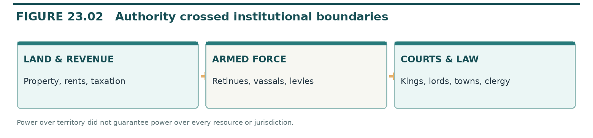

Представи си училищна диаграма с крал на върха, благородници под него, рицари под тях и селяни в базата. Това прави средновековното общество да изглежда като проста пирамида. И все пак известната формула, наречена феодализъм, е станала спорна сред историците, защото взаимоотношенията на земя, военна служба, наем и юрисдикция са се различавали толкова много между региони и векове. Владичеството може да подкрепя военната служба; клетвата може да обвързва определени хора; епископ или манастир може да има правомощия, обикновено възложени на благородници; и царски офицери понякога заобикаля местните магнати. Нищо от това не е формирало една универсална европейска конституция.

Вместо това попитай кой притежава три конкретни неща: земя и приходи; въоръжена сила и власт да съди споровете. Отговорът може да е различен в същия район. В една английска област кралските съдилища и шерифите може да стигнат по-далеч отколкото в фрагментирано княжество другаде. В рамките на Свещената Римска империя императорската власт била договорена с принцове, епископи и градове. В някои части на Франция каветските царе постепенно разширявали прекия контрол от сравнително тясна област. Лордовете били могъщи не защото царят бил раздал всеки акър в една подредена верига, а защото собствеността, обичаят, личните задължения и военните ресурси създали неравномерна сила.

Историците също така разграничават Васалаж, лична връзка на лоялност и реципрочно задължение, от маниерни договорености, свързващи хазяи и селскостопански домакинства. Някои селяни бяха законно свободни; други притежаваха договорени права и степени на мобилност. Моделът на перфектно фиксирана йерархия пропуска конфликти, съдилища, петиции, сделки и промени с течение на времето. Когато видите думата феодал, попитайте автора какво точно означава, къде се прилага и какви източници го демонстрират.

<figure class="figure" id="figure-23-2">

<figcaption>Фигура 23.2. Властта над територията не гарантира власт над всеки ресурс или юрисдикция. <a class="figure-anchor" href="#figure-23-2" aria-label="Link to this figure">#</a></figcaption>
</figure>
