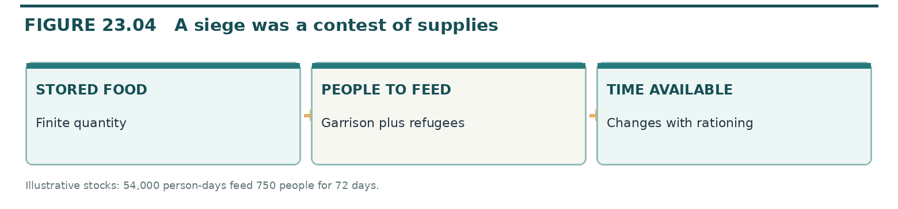

Средновековни бойни сцени предизборни доспехи и лична храброст, но трайната сила зависела от набирането, храненето и заплащането на хората. Планинските воини можели да предизвикат шок в някои среди; пехотата с копия, арбалети, лъкове и евентуално все по - резултатни ракетни оръжия също имала значение. Полеви армии не са взаимозаменяеми: сила, успешна на открит терен може да се бори срещу укрепени проходи или дълги обсади. Крепости контролирани пътища, пресичания, съхранение и политически центрове. Те бяха инвестиции в камък, труд, водоснабдяване, храна и войници, а не магически препятствия, които се съпротивляваха за неопределено време.

Обсадата може да завърши с нападение, преговори, облекчение от съюзническа армия, предателство, глад или болести. Бесигерите са консумирали провизии, докато са се опитвали да спрат доставките на защитниците. Местните цивилни платиха цена чрез реквизиция, унищожение на култури и преместване. В граничните райони малките гарнизони и сезонните нападения понякога са били по - важни за ежедневието, отколкото честваните битки. Самата архитектура на замъка се промени в отговор на новите методи на обсада и наличните ресурси на владетелите. Защитните системи станаха особено скъпи, когато артилерията узрее, но оръжията веднага не направиха стените без значение: земни работи, ремонти, инженери и защитени позиции промениха баланса многократно.

Да разгледаме един измислен пример. Гарнизонът съхранява храна за 600 души в продължение на 90 дни: това представлява 54 000 индивидуални дни преди отчитане на отпадъци или различни дажби. Ако 300 бежанци влизат и не пристигат доставки, простата аритметика намалява продължителността на 60 дни. Реалността е по-объркана, но упражнението показва защо командирите трябва да обмислят цивилни, потребление и достъп до вода. Добрата военна история свързва оръжията с труда, фискалния капацитет и изборите, пред които са изправени невоенните бойци.

<figure class="figure" id="figure-23-4">

<figcaption>Фигура 23.4. Илюстративни запаси: 54 000 дневни храни 750 души за 72 дни. <a class="figure-anchor" href="#figure-23-4" aria-label="Link to this figure">#</a></figcaption>
</figure>
