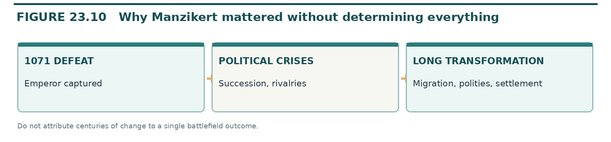

През 1071 византийски сили по Романос IV Диоген бяха победени от армия на Селджук, водена от Алп Арслан в Манзикерт в Източна Анадола. Императорът бил заловен и по-късно освободен. Учебниците често представят събитието като единствената битка, която накарала Византия да загуби Анадола и неизбежно донесла османското завоевание векове по - късно. Това компресира сложен процес в драматична, но подвеждаща стрела. Манзикерт отслаби политическата стабилност и престиж, но вътрешните борби, регионалния военен упадък, преместващите се съюзи, миграцията, нападенията и появата на ръководените от турците поляци имаха голямо значение през следващите години.

Турското селище и ислямизацията в Анадола не се случиха нито за една нощ, нито по еднакъв начин. Местни християнски общности, гръцкоговорящи градове, арменско население, мюсюлмански новодошли и многобройни владетели общуваха през поколенията. Селюкският султанат на рома установи властта в части от полуострова, заедно с други турски, византийски и местни политически структури. В края на единадесети век византийците потърсили помощ от Запада, но западните експедиции служели на дневен ред, който никога не бил напълно подчинен на императорските цели.

Задачата на историка е да свърже военното поражение с условията, които са го превърнали в политическа трансформация. Защо империята не успяла да обърне някои загуби? Как последвалите кризи се отразиха на набирането и командването? В кои области са останали властите? Бойното поле може да разкрие слабост, а не сама да причини всяка последица, която му се приписва. Манзикерт е важен именно защото задгробният му живот стана част от политическата идентичност и историческите аргументи далеч над 1071.

<figure class="figure" id="figure-23-10">

<figcaption>Фигура 23.10. Не приписвайте вековната промяна на нито едно бойно поле. <a class="figure-anchor" href="#figure-23-10" aria-label="Link to this figure">#</a></figcaption>
</figure>
