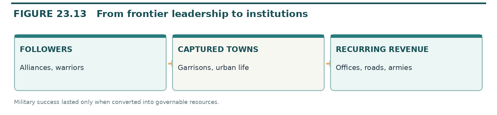

Отоманската династия взема името си от Осман, традиционно наречен Осман I, чието ръководство принадлежи към края на XIV век. Източниците на ранния му живот са оскъдни, а по-късно хрониките съдържат легенди за произхода им, когато династията вече е била могъща. Една влиятелна традиция изобразява една мечта, предвиждаща огромно правило; тя ни разказва много за по-късните идеали на династичната легитимност, но малко, които могат да бъдат независимо проверени за спящия ум на Осман. Историците обсъждат ролите на пограничните войни, мюсюлманските воини идентичности, съюзите, племенните мрежи, икономическите възможности и набирането на персонал сред разнообразно население.

Срещата, известна като битката при Бафей през 1302 г., е важен маркер за разширяване на Османската военна дейност близо до византийска територия, но не бива да се разглежда като моментално появяваща се империя. Това, което можем да предположим по-уверено е, че наследниците на Осман са били разположени, за да се възползват от отслабването на византийската власт и конкуриращите се Анадолски сили. Те привличали последователите си, като раздавали облаги, предлагали ръководство и провеждали кампании, които увеличавали достъпа до селища и приходи.

Терминът "гази," свързан с воин на вярата или пограничния войн, се появява в историческите дискусии на ранната династия. Дали само ghaza обяснява османската експанзия се оспорва. Изборът на воини може да смеси преданите ангажименти с лична лоялност, търсенето на плячка, местната политика и перспективата за земя или офис. Внимателна история оставя място за осъждане, докато отказва идеята, че един лозунг определя всяко действие. Османската поява е по-добре разбрана като растеж на адаптивна политическа мрежа, отколкото като изпълнение на предопределена легенда.

<figure class="figure" id="figure-23-13">

<figcaption>Фигура 23.13. Военен успех продължи само когато се превърна в управлявани ресурси. <a class="figure-anchor" href="#figure-23-13" aria-label="Link to this figure">#</a></figcaption>
</figure>
