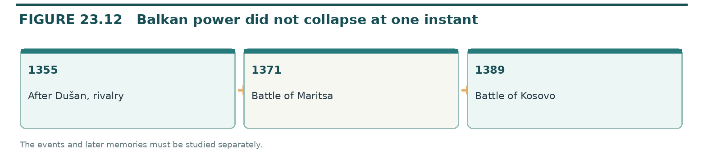

Сръбските владетели разшириха влиянието си на средновековните Балкани, като често се съревноваваха и преговаряха с Византия, България, Унгария и други. Под командването на Стефан Душан през четиринадесети век сръбската власт достигна поразителен териториален мащаб и императорските претенции бяха напреднали. Но държавата не беше непробиваем национален блок. Управляващите му семейства управлявали различни региони, църкви, аристократични интереси и правни традиции. Кодексът на закона на Душан предоставя доказателства за политическа амбиция, социална регулация и правна мисъл, но подобно на всеки законов кодекс, той трябва да бъде сравнен с действителната практика.

След смъртта на Душан през 1355 г., конкурентните регионални владетели станали по - видни. Битката при Марица през 1371 г. бе основна османска победа над силите, водени от сръбски магнати, допринасящи за променящия се баланс на Централните Балкани. Битката за Косово през 1389 г. придоби изключително силни национални и религиозни значения в по-късната си памет. Историческата битка включваше сложна коалиция от сили; както Султан Мурад I, така и принц Лазар умряха, а непосредственият политически резултат не трябва да се бърка с по-късните епични разкази за героични жертвоприношения и национална съдба. Османската консолидация е настъпила чрез по-късни кампании, преговори и отношения на зависимост, без нито едно мигновено изчезване на всяка сръбска полщина през 1389 г.

Историците изследват хроники, османски записи, надписи и по-късно предаване на епични традиции. Поема, съставена поколения по - късно, може да бъде отлично доказателство за това, което една общност помни и цени, като същевременно остава недостатъчно доказателство за точните думи, изречени на бойното поле. Разликата между събитието и паметта защитава както историческото проучване, така и законното изследване на културната идентичност. Тя също така прави регионалната история по-малко уязвима от съвременните твърдения, че средновековните граници определят настоящите политически права.

<figure class="figure" id="figure-23-12">

<figcaption>Фигура 23.12. Събитията и по-късните спомени трябва да бъдат изучавани отделно. <a class="figure-anchor" href="#figure-23-12" aria-label="Link to this figure">#</a></figcaption>
</figure>
