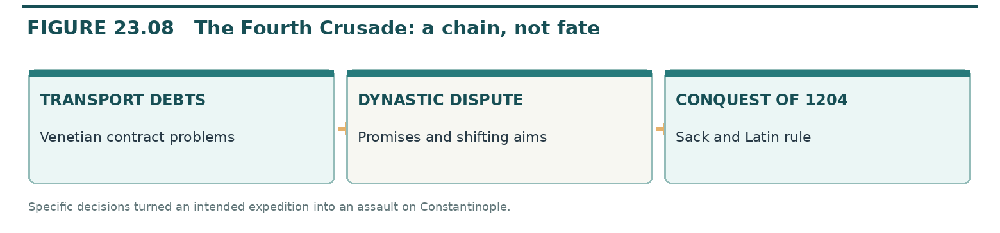

Четвъртият кръстоносен поход първоначално е имал за цел да се изправи срещу мюсюлманската власт в източното Средиземноморие, с Египет централно за неговото планиране. Финансирането на експедицията беше трудно. Кръстоносците се договорили с Венеция за транспорт и натрупани задължения, които те се борили да изпълнят. Предприятието било отклонено първо към Зара, християнски град на Адриатическо море, а след това се замесил във византийски династичен спор. Обещанията за плащане, военната помощ и църковния съюз създадоха стимули, които командирите не можеха надеждно да изпълнят. През април 1204 г. кръстоносните войски конфискували и уволнили Константинопол, един от най-големите християнски градове в света.

Това не било просто случайност, причинена от един алчен търговец или вечната омраза на една вяра към друга. Венецианските търговски интереси, решенията на латинското ръководство, византийските конфликти на наследяване, финансовият натиск, взаимното подозрение и разпадането на преговорите изиграха роля. Нито е бил неизбежен резултат от теологията. Специфични лидери взеха решения при обстоятелства, при които съществуват алтернативи. Последвалата Латинска империя контролирала Константинопол, докато византийските наследници на правителства се развивали в Никея, Епир и Требизонд и латинските княжества заемали други територии. Балансът на сила в Егейско море и Балканите бе трансформиран.

Унищожението, премахването на произведенията на изкуството и политическото дислокация навредиха на византийските институции и задълбочи недоверието между латинските и православните християни. Загубата била много по-важна от физическото богатство: било оспорвано императорската легитимност, църковната юрисдикция, военноморския достъп и данъчните приходи. Историкът трябва да обясни веригата от решения, вместо да превърне 1204 в доказателство, че цялата религия или цивилизация е еднакво враждебна към друга.

<figure class="figure" id="figure-23-8">

<figcaption>Фигура 23.8. Специфични решения превърнаха експедицията в нападение над Константинопол. <a class="figure-anchor" href="#figure-23-8" aria-label="Link to this figure">#</a></figcaption>
</figure>
