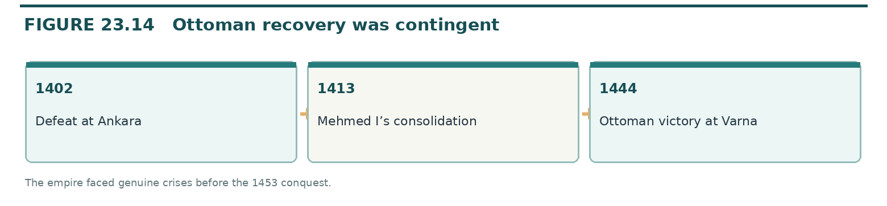

Османската експанзия беше впечатляваща, но не неизбежна. През 1402 г. Тимур победи Баязид I в битката при Анкара, а Баязид бе заловен. Поражението нарушило османската власт и допринесло за борбата между синовете на Баязид, често наричан Османския интеррегнум. Конкурентните принцове разчитаха на регионални военни поддръжници, местни елити и съюзници както в Анатолия, така и на Балканите. Някои територии и съперници си върнаха място за маневриране. По - късна империя, която изглеждала постоянна, все още можела да се пречупи драматично, когато наследяването и военното състояние се променили.

Мехмед аз възстанових централно династично лидерство през 1413. Неговият наследник Мурад II консолидира и разшири османската власт по време на подновени борби на Балканите и Анадола. През 1444 г. силите, водени от полския-унгарския крал Владислав III, в съюз с други анти-отомански сили, бяха победени във Варна. Битката сложи край на голяма кампания за кръстоносни действия и потвърди, че латино-балканските коалиционни сили са изправени пред страхотни османски армии, въпреки че не премахват всеки противник или не уреждат бъдещето на региона. Поражението на Косово през 1448 г. допълнително провери опитите за обръщане на османския напредък.

Тези събития показват защо трябва да следваме годините между известни завоевания. Османската победа през 1453 г. не била гарантирана през 1402 г. Възстановяването изисква политическо договаряне, мобилизиране на ресурси, стратегически съюзи и принуда. Тя също зависеше от избора и слабостите на съперниците, а не само от превъзходството на една армия. Времевата линия на смущенията и възстановяването е по-добро обяснение от права линия от Осман до Константинопол и разкрива как изграждането на империя често включва повтарящи се моменти, когато колапсът е възможен.

<figure class="figure" id="figure-23-14">

<figcaption>Фигура 23.14. Империята се сблъскала с истински кризи преди завоеванието от 1453 г. <a class="figure-anchor" href="#figure-23-14" aria-label="Link to this figure">#</a></figcaption>
</figure>
