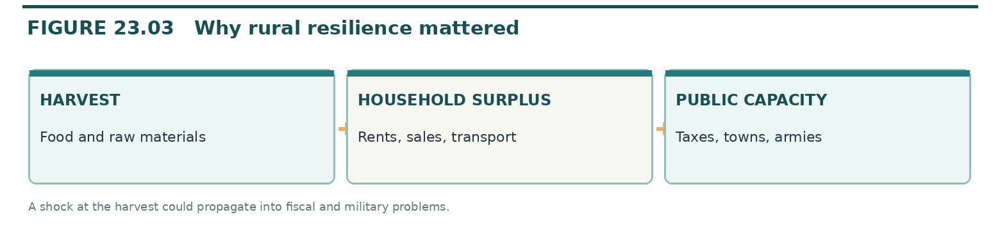

Замъкът, катедралата и кралската армия изисквали излишна храна, дрехи, дървен материал, метал и транспорт. Повечето средновековни хора са живели в селските общности, въпреки че пропорцията се е променила в регионите и вековете. Фермерите са работили по парцели под смесица от собственост, наем и задължение. Домакинствата са използвали животни за разораване и трасиране, управлявани пасища и гори и адаптирани към местните валежи, почви и сезони на отглеждане. Благородни права на собственост биха могли да бъдат мощни, но селата понякога регулирани споделени полета, паша и използване на ресурсите чрез колективен обичай.

Избягвай да си представяш всеки селянин като също толкова беден или безсилен. Някои домакинства притежаваха значителна земя, наемаха работници или заемаха зърно; други бяха изправени пред несигурност, принудителен труд, наем и внезапни налози. Женският труд беше от основно значение за производството, преработката на храни, текстилната работа, пазарите и семейното оцеляване, въпреки че правните възможности и правата на наследството се различаваха рязко. Децата работеха и се учеха в домакинствата и търговията, докато миграцията и бракът свързваха селата с по-широки икономики. Лордовете и манастирите може да пазят подробни записи за наема, но тези разкази често измерват задълженията по - добре от емоциите или действителните стандарти на живот.

Промяната в селското стопанство беше кумулативна. В подходящите региони подобрените колани, мелниците, сеитбообращението, дренажът и разширяващото се селище допринасят за по-голяма продукция. Растежът на населението преди четиринадесети век оказва натиск върху маргиналните земи и прави общностите уязвими, когато реколтата се проваля. Провалената култура може да намали храната, да увеличи дълга, да подкопае данъчните приходи и да направи болестите по-опасни. Урокът е системен: политическата власт се основава на продуктивния капацитет и устойчивостта на домакинствата, чиито имена рядко се появяват в кралските хроники.

<figure class="figure" id="figure-23-3">

<figcaption>Фигура 23.3. Шокът от прибирането на реколтата може да се разпространи във финансови и военни проблеми. <a class="figure-anchor" href="#figure-23-3" aria-label="Link to this figure">#</a></figcaption>
</figure>
