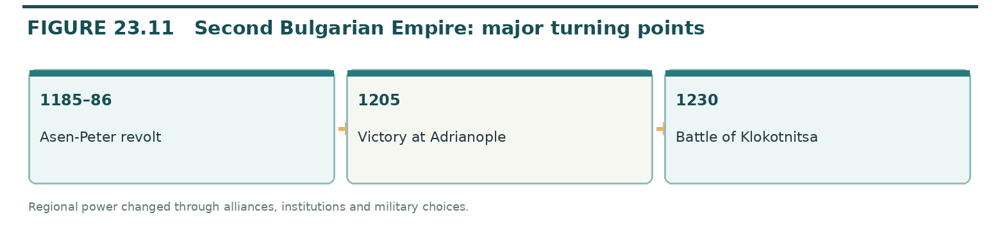

През 1185 и 86 г. въстание, свързано с братята Петър и Асен, доведе до възстановяването на независима българска полка, традиционно наречена Втора българска империя. Центърът му в Търново се превърна в основна политическа и културна столица. Това възстановяване не просто съживи всяка институция на Първата българска империя без промяна. Управляващите действат в пейзажа на византийската слабост, регионалните аристократични интереси, кубинските съюзи, латинското кръстопътство и конкуриращите се балкански сили. Политическите титли, църковното признаване и брачните съюзи могат да бъдат толкова важни, колкото победите на бойното поле.

Калоян, владетел от династията Асен, постига драматична победа над силите на новата Латинска империя в Одрин през 1205 г., където латино император Болдуин бях заловен. Събитието показва, че чувалът на Константинопол не е дал на западните кръстоносци безпрепятствен контрол над Балканите. При Иван Асен II, който управлява от 1218 до 1241 г., българската власт се разширява чрез комбинация от дипломация и военен успех. Битката при Клокотница през 1230 г. се превърна в забележителност в регионалното възход на кралството. И все пак политическото сближаване не трябва да се бърка с еднообразната окупация: влиянието, приложните отношения и пряката администрация бяха различни форми на власт.

По - късно владетелите се сблъскали с аристократична конкуренция, монголско влияние и регионална фрагментация. Българската политическа история през тези векове включваше преговори с Византия, сръбските владетели, степните сили и латинското общество. Важността му не е само национална гордост. Търново показва как една държава, разположена между големите имперски системи, може да създаде свой собствен дипломатически дневен ред, религиозни институции и отличителен артистичен живот, докато остава изложена на същия структурен натиск, който затруднява съседите.

<figure class="figure" id="figure-23-11">

<figcaption>Фигура 23.11. Регионалната власт се променя чрез съюзи, институции и военни избори. <a class="figure-anchor" href="#figure-23-11" aria-label="Link to this figure">#</a></figcaption>
</figure>
