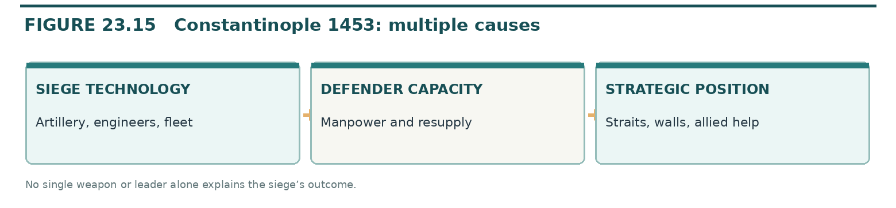

През април 1453 г. младият султан Мехмед II започва съвместна обсада на Константинопол. Градът заема стратегическа позиция между черноморските и средиземноморските светове, с огромни земни стени и защити около Златния рог. Силите на Мехмед включваха артилерия, военноморска сила, инженери, пехотинци и командири, координиращи продължителното налягане. Византийските защитници, водени от Константин XI и обединени от чуждестранни съюзници, включително Дженоеските войски, се сблъскали с недостиг на работна ръка и ресурси. Обсадата приключва на 29 май 1453 г., когато османските войски влизат в града и последният византийски император умира по време на защитата си.

Големи бомбардировки и друга артилерия допринесли за обсадата, но популярният образ на едно оръдие мигновено разбивайки иначе непревземаем свят е подвеждащ. Намалените ресурси на града, постоянните атаки, усилията за ремонт, борбата с достъпа до море и ограничената способност на външните владетели да се намесват всички са от значение. Съвременните и почти съвременни разкази дават различни разкази за конкретни нападения и героизъм. Не трябва да рекламираме всеки анекдот за порта, поличба или последната реч в действителност. Завоеванието включвало също страдания и грабежи, заедно с усилията на новия владетел да установи и насели имперска столица.

В един смисъл 1453 е края: Константинопол престава да бъде столица на независим римски-Византийски император. В друг смисъл беше трансформация. Османците направиха столицата своя столица и продължиха да използват, преустрояват и запазват избрани елементи от градското и административно наследство. Византийското изкуство, православните институции, стипендията и политическите идеи продължиха другаде, включително в балканските и източните християнски общества и в контакти с италиански центрове. Падането не е причинило механично Ренесанса, затваряйки всеки източен търговски маршрут или отбелязвайки мигновеното раждане на модерността. Тя промени равновесието на властта по начини, чиито последствия зависеха от изборите, направени след това.

<figure class="figure" id="figure-23-15">

<figcaption>Фигура 23.15. Само нито едно оръжие или водач не обяснява загадката. <a class="figure-anchor" href="#figure-23-15" aria-label="Link to this figure">#</a></figcaption>
</figure>
