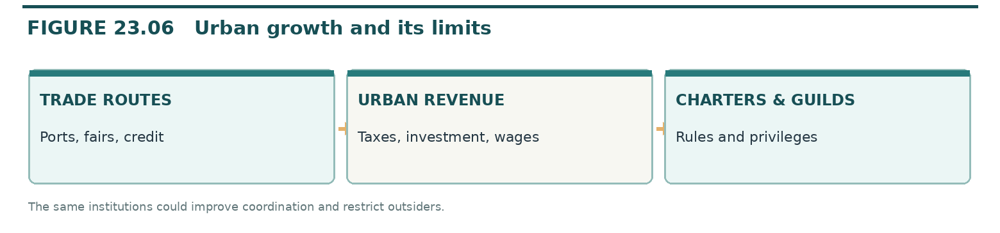

Средновековните градове не всички били съживени римски градове. Някои се разрастват около пристанища, укрепени центрове, дестинации за поклонение, минни райони или търговски панаири. Търговското разширяване свързва производството на фламандски плат, английската вълна, северното италианско финансиране, балтийския дървен материал и зърното, средиземноморското корабоплаване и вътрешния пазар. Венеция и Генуа са изградили обширни морски мрежи, докато Хансатичната лига е организирала сътрудничество и привилегии сред северните търговци и градове. Тези връзки се пресичат с Пътите на коприната и системите на Индийския океан, проучени в глава 21, въпреки че политическите граници и митническите такси правят обмена скъп.

Градските жители са договорили харта и освобождаване от някои лордски задължения. Гилдията и други занаятчийски организации могат да регулират обучението, качеството, членството, взаимната помощ и достъпа до пазарите. Тяхната цел не винаги е била просто защита на потребителите; те също така могат да ограничат конкуренцията и да защитят вътрешните лица. Търговците изисквали доверен кредит, записи и начини за прилагане на сделки на разстояние, които не можели лично да контролират. Религията, родството, репутацията и законът им помогнали да управляват риска, докато измамата и конфликтът никога не отсъствали.

Растежът доведе до ново неравенство. Просперираща търговска къща и несигурен работник може да живеят в един и същ укрепен град. Гладът и епидемията могат да преминат през търговски връзки. Градовете обаче били политически важни, защото данъчното богатство и организираните граждани давали на владетелите нови партньори и съперници. Попитайте дали дадена градска институция е увеличила възможностите за някои хора, като са изключили други. Отговорът се променя от град на град и ни пречи да романтизираме пазарите или гилдията.

<figure class="figure" id="figure-23-6">

<figcaption>Фигура 23.6. Същите институции могат да подобрят координацията и да ограничат външните лица. <a class="figure-anchor" href="#figure-23-6" aria-label="Link to this figure">#</a></figcaption>
</figure>
