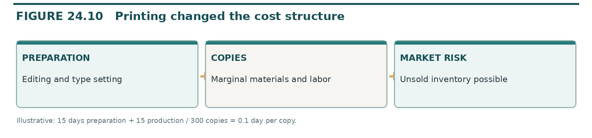

Хипотетичното сравнение прави мащабния ефект осезаем. Да предположим, че един квалифициран писар се нуждае от 20 работни дни, за да копира и провери един дълъг текст. Десет книжници, работещи паралелно, могат да завършат десет екземпляра за около 20 дни, пренебрегвайки различни скорости и подготовка. Сега си представете печатница, която първо прекарва 15 дни в подготовка на тип и доказателства и след това произвежда 300 копия за още 15 работни дни. Този опростен сценарий предполага, че големите разпечатки могат да разпространят фиксираните разходи за подготовка в много книги. Не се знае колко бързо работи истинската преса от 15-ти век. Тези цени зависят от размера на страниците, сложността, наличния тип, организацията на работниците, хартията и търсенето.

Можем да изразим контраста по-внимателно. За ръкопис много разходи за труд се повтарят за всяко допълнително копие. За печатно издание подготовката на типа и илюстрациите е сравнително голям първоначален разход, докато допълнителните копия имат по-малки пределни разходи, докато оборудването или материалите станат ограничения. Ако търсенето е слабо, принтерът може да загуби пари от непродадена стока. Печатането не винаги е по-евтино за еднократен документ. По този начин размерът на пазара и очакваните продажби са също толкова важни, колкото технологията.

Видимата полза от копирането на ефективността не означава, че всички книги веднага стават достъпни за всяко семейство. Грамотност, език, цена, време, достъп до продавачи и социално разрешение оформени публика. Споделеното четене, рецитиране и проповядване биха могли да разширят влиянието отвъд индивидуалната собственост на книгата. От икономическа гледна точка съответните иновации не бяха, че една машина замени всеки писар; именно новите комбинации от фиксирани разходи, сперматогенеза и разпределение промениха възможностите за производство и разпространение на текстове. \[<a href="/024-renaissance-humanism-and-printing/sources/#source-24" class="cite">24</a>\]

<figure class="figure" id="figure-24-10">

<figcaption>Фигура 24.10. Illustrative: 15 дни подготовка + 15 продукция / 300 копия = 0.1 ден на копие. <a class="figure-anchor" href="#figure-24-10" aria-label="Link to this figure">#</a></figcaption>
</figure>
