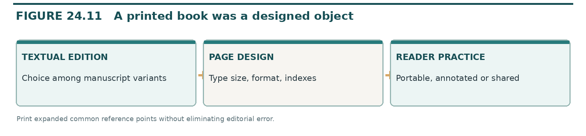

Венецианският принтер Алдус Манутий, активен в края на петнадесети и началото на шестнадесети век, се свързва с внимателно редактирани издания на класически текстове, гръцка типография и компактни формати книга. Неговите издания Aldine илюстрират как техническите и търговските избори могат да служат на научна визия. По-малък обем е по-лесно за някои читатели да носят и да се консултират от масивна книга бюро, въпреки че преносим не означава автоматично евтини или достъпни за всеки социален клас. Издателската програма на Алдус привлече редактори, тип дизайнери, финансисти и международното търсене на гръцко и латино обучение. \[<a href="/024-renaissance-humanism-and-printing/sources/#source-26" class="cite">26</a>\]

Принтерът може да промени стипендията не чрез генериране на оригинални аргументи, а чрез създаване на общ текст за далечните читатели. Учените, които притежавали същото издание, можели да цитират пасажи, да сравняват грешките и промените в обменния курс. Въпреки това вестителите може да избират между съперническите ръкописни традиции, като решават какво се счита за авторитетна формулировка. Веднъж възпроизведени широко, тези решения могат да станат трудни за оспорване. Отпечатването умножаваше както добрата стипендия, така и редакционните грешки.

Пресата "Алдин" също ни напомня, че дизайнът сам по себе си е историческо доказателство. Размерите на страниците, шрифта, маржовете, пунктуацията и подредбата на индекса ни казват как производителите очакват читателите да използват книга. Едно красиво изработено издание може да поддържа близко четене; то също така може да сигнализира статус. Съвременните читатели, които смятат, че информацията съществува отделно от нейната средна перспектива за това как физическата форма на книгите влияе върху навигацията, собствеността и социалната идентичност на читателите. \[<a href="/024-renaissance-humanism-and-printing/sources/#source-24" class="cite">24</a>\]\[<a href="/024-renaissance-humanism-and-printing/sources/#source-26" class="cite">26</a>\]

<figure class="figure" id="figure-24-11">

<figcaption>Фигура 24.11. Отпечатване разширени общи референтни точки, без премахване на редакционна грешка. <a class="figure-anchor" href="#figure-24-11" aria-label="Link to this figure">#</a></figcaption>
</figure>
