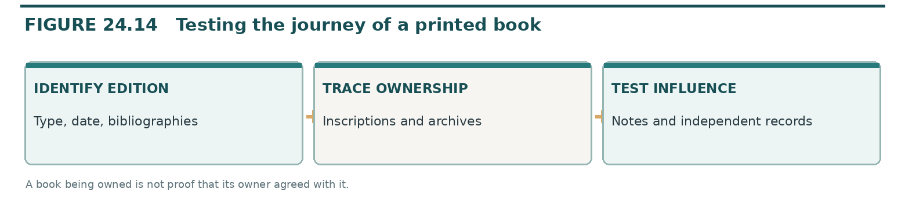

Представете си, че историк открива латинско издание на Цицерон, отпечатано във Венеция около 1500 г., по - късно собственост на учител в северен град. Заглавната страница и шрифтът предполагат принтер, ръкописен надпис назовава възможен собственик, а пределните бележки обсъждат спорни пасажи. Библиотечен каталог от шестнадесети век записва книга с подобно заглавие. Това е хипотетично упражнение, а не описание на определено оцеляло копие. Доказателствата представят една привлекателна история: италианско хуманистично издание пътувало на север и променило мисленето на учителя. Какво щяло да установи всяка част?

Първо, идентифицирайте изданието чрез сравняване на типа, колацията и библиографските записи. Второ, установи дали надписът принадлежи към периода и дали името на учителя може да бъде идентифицирано самостоятелно. Трето, разгледай бележките за дати, препратки или доказателства за действително четене. Четвърто, различавай кръвообращението от влиянието. Собствеността доказва, че една книга е достигнала до колекция; тя не доказва, че собственикът се е съгласил със съдържанието или преподава от нея. Ако друго копие оцелее, сравнете вариантите, обвързването и анотация, за да проучите опита на различни читатели.

Това малко проучване улавя методите на главата: материални доказателства, език, произход, икономически мрежи и несигурност. Една красиво отпечатана книга може да бъде културно важна, дори ако не можем да възстановим всеки читател. От друга страна, широкото твърдение, че печатът е причинил конкретно политическо събитие, изисква доказателства извън съществуването на печатни страници. Правилното заключение е пропорционално на наличните доказателства. Работата на един интелектуален историк прилича на работата на детектив, който трябва да разбере както предмета, така и институциите, които са му позволили да пътува.

<figure class="figure" id="figure-24-14">

<figcaption>Фигура 24.14. Притежавана книга не е доказателство, че собственикът й се е съгласил с нея. <a class="figure-anchor" href="#figure-24-14" aria-label="Link to this figure">#</a></figcaption>
</figure>
