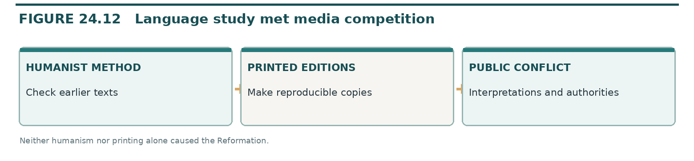

Desiderius Erasmous of Rotterdam (с т. 1466 и 1536 г.) комбинира класическо езиково изучаване с християнска морална критика. Той насърчавал вниманието към източниците на християнската традиция, поставял под въпрос някои практики и използувал сатирата, за да разкрие претенциите си. През 1516 г. гръцки текст на Новия завет се появява в печат с новия латински превод на Еразъм. Това било важно събитие в научната и религиозната история, макар че нито изданието на Еразъм, нито методологията му били извън критиката. Изборът на ръкописи, преводни решения и по - късно ревизирани издания става въпрос за обсъждане. \[<a href="/024-renaissance-humanism-and-printing/sources/#source-29" class="cite">29</a>\]

Програмата често е описвана като рекламен шрифт на търсачките, което означава връщане към ранните текстове и изучаване на езиците, необходими за тяхното изследване. Тя може да подкрепи традиционната преданост, институционална реформа или спорове, които отидоха по-далеч от първоначалния учен. Да си представим хуманистите като еднакво анти-църковни би било неточно: мнозина се опитваха да засилят християнския живот чрез образование и критика. Нито пък всеки противник на църковните злоупотреби е съгласен с доктрината или политическите действия.

Отпечатването усилва тези аргументи, като прави научните издания, популярните религиозни текстове и критиките по-лесни за възпроизвеждане. Но Реформацията през шестнадесети век също зависела от владетели, духовници, градски общности, богословски разногласия и спорове относно властта. Глава 25 ще разгледа тези конфликти по свое собствено право. Тук трябва да запазим по-тесен урок: Ренесансовите текстови техники променят условията, при които религиозните претенции могат да бъдат защитавани или оспорвани, докато печатната страница не решава коя интерпретация е вярна. \[<a href="/024-renaissance-humanism-and-printing/sources/#source-27" class="cite">27</a>\]\[<a href="/024-renaissance-humanism-and-printing/sources/#source-29" class="cite">29</a>\]

<figure class="figure" id="figure-24-12">

<figcaption>Фигура 24.12. Нито хуманизмът, нито печатът сами по себе си причинили Реформацията. <a class="figure-anchor" href="#figure-24-12" aria-label="Link to this figure">#</a></figcaption>
</figure>
