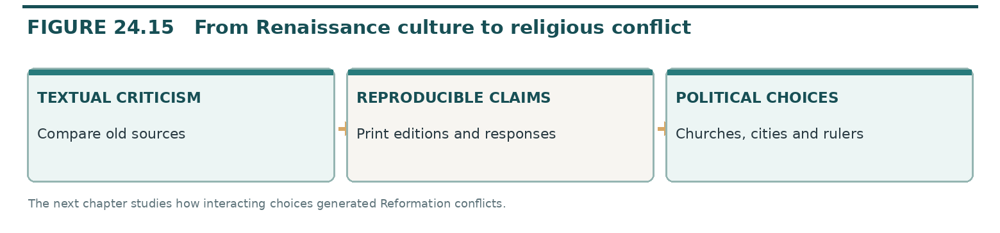

Върнете се към въображаемия флорентинец от самото начало. Ръкописите не са изчезнали; някои от тях сега се редактират и печатат. Художниците все още преговарят с покровители; няколко техники са станали поучителни модели. Търговците продължават да финансират предприятия, включително новата дейност по производство на книги. Духове, принцове и учени четат конкурентни версии на важни текстове. Промените са съществени, но никой не е премахнал по-старите институции или не е сключил универсално споразумение.

Сега се появява централна връзка. Изследването на хуманистичния език позволявало на учените да изследват по - критично наследените религиозни и политически твърдения. Печатането улеснило възпроизвеждането на издания, критики, илюстрации и отговори. Политическите и религиозните институции се опитаха да използват или регулират тези канали. Комбинацията не определи кои идеи ще триумфират; тя умножи възможностите както за убеждаване, така и за конфликт. Хората, които споделяли целта за обновление на християните, може да не са съгласни с методите, авторитета и значението на Писанието.

Глава 25, Реформацията и религиозният конфликт ще последват тези разногласия в църкви, домакинства, кралски съдилища и бойни полета. Нашият подход няма да предположи, че само печатането е създало Реформацията или че ренесансовите хуманисти са я подкрепяли еднакво. Урокът от глава 24 е по-взискателен: разбиране на културните промени като мрежа от практики, ресурси, стимули и институции. Ренесансът не е светлина, включена след мрака. Това е спорен процес, чрез който хората преизчислиха наследството, което вече притежаваха и изградиха нови средства за разпространението му.

<figure class="figure" id="figure-24-15">

<figcaption>Фигура 24.15. Следващата глава изследва как взаимодействието между изборите поражда конфликти на Реформацията. <a class="figure-anchor" href="#figure-24-15" aria-label="Link to this figure">#</a></figcaption>
</figure>
