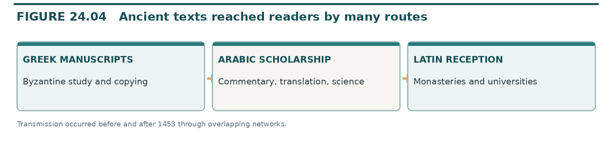

Ученето на гръцки език в Западна Европа се разшири чрез постоянен контакт с византийския свят. Учители като Мануел Хризолорас преподава гръцки в Италия около края на петнадесети век, и учени присъстваха църковни съвети, преследва дипломатически мисии и обменя ръкописи през Адриатическо море. След 1453 г. други гръцки говорещи учени мигрирали или работили при нови политически обстоятелства. И все пак тези миграции продължават дълга история на обмен и не трябва да се третират като внезапното предаване на цивилизацията към иначе празен интелектуален пейзаж.

Древните източници са достигнали Европа с повече от един маршрут. Класически гръцки и римски текстове са съществували във византийски колекции и латински манастири; арабски и персийски научни традиции са запазени, критикувани и разширени произведения по философия, астрономия, медицина и математика. Преводът на латински е процъфтявал през миналите векове, особено в мултикултурните зони за контакт. Учените от Ренесанса понякога се връщали в гръцките оригинали, за да проверят по - ранните версии, но връщането към оригиналния текст не означавало, че преводачите и коментаторите на други езици не допринесли нищо.

Търговските и политическите отношения свързват също италианските градове с османските пристанища и други източносредиземноморски общества. Враждебността и културният обмен биха могли да съществуват съвместно: търговците могат да преговарят за лицензи и товари, докато владетелите се състезаваха военно. Когато обсъждаме интелектуалното наследство на Ренесанса, проследяваме веригата на копиране, превод, корабоплаване, преподаване и печат на всяка книга. "Гръцкото знание достигна Италия" е непълно изречение, освен ако не обясним кой го е запазил, кой го е предал, кой може да го прочете и кой е платил за тази работа. \[<a href="/024-renaissance-humanism-and-printing/sources/#source-4" class="cite">4</a>\]\[<a href="/024-renaissance-humanism-and-printing/sources/#source-10" class="cite">10</a>\]

<figure class="figure" id="figure-24-4">

<figcaption>Фигура 24.4. Предаването е извършено преди и след 1453 г. чрез припокриващи се мрежи. <a class="figure-anchor" href="#figure-24-4" aria-label="Link to this figure">#</a></figcaption>
</figure>
