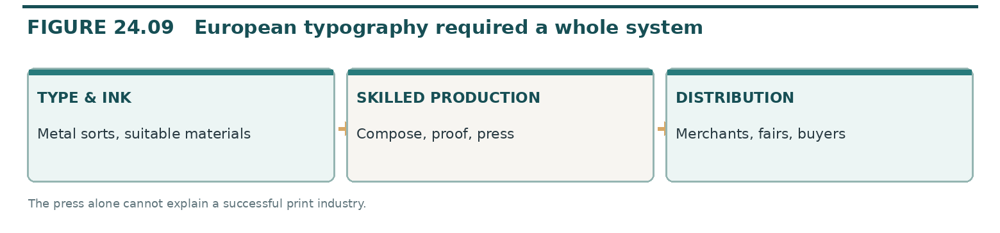

В средата на петнадесети век Майнц, Йоханес Гутенберг и сътрудници разработиха високоефективна европейска система за типографски печат. Могат да се произвеждат и сглобяват еднакви метални букви в линии, комбинирани с печатно мастило, подходящо за процеса, и притиснати многократно срещу хартия или пергамент. Композиторите могат да пренаредят типа за следващата страница. Пресата беше само един елемент от това начинание. Техническият пробив в интегрирането на производството, състава, мастилото, налягането, квалифицирания труд и финансирането в възпроизводим работен процес. \[<a href="/024-renaissance-humanism-and-printing/sources/#source-23" class="cite">23</a>\]

Известната Библия Гутенберг, една голяма латинска Библия, която обикновено датира от около 1444-45 г., показала амбицията на новия процес. Неговите страници, обикновено подредени в две колони с четиридесет и две линии, съзнателно приличат на елегантни ръкописи. Тази прилика е поучителна: ранните принтери първоначално продавали книги на читатели, запознати с конвенциите на ръкописите, а не с публично желание за изцяло нови медии. Декорацията на ръката понякога се добавя след печат. Точните детайли на уъркшопа и отговорностите могат да бъдат трудни за възстановяване, особено защото правните и бизнес спорове оформиха оцелелите доказателства.

Гутенберг не е инициирал лично цялата европейска търговия с книги или сам е изобретил всеки компонент. Принтери, инвеститори, металообработващи машини, производители на хартия, редактори и книжарници разшириха системата в градовете. Финансовият риск остава висок: вид, материали и квалифицирани работници изискват инвестиции преди да започнат продажбите. Бързото разпространение на пресата е резултат от техническа ефективност, съчетана с трудова мобилност, градски пазари и търсене от църкви, университети, съдилища и търговци. Машината има историческо значение, когато мрежа от институции я прави полезна в мащаб.

<figure class="figure" id="figure-24-9">

<figcaption>Фигура 24.9. Само пресата не може да обясни успешната печатница. <a class="figure-anchor" href="#figure-24-9" aria-label="Link to this figure">#</a></figcaption>
</figure>
