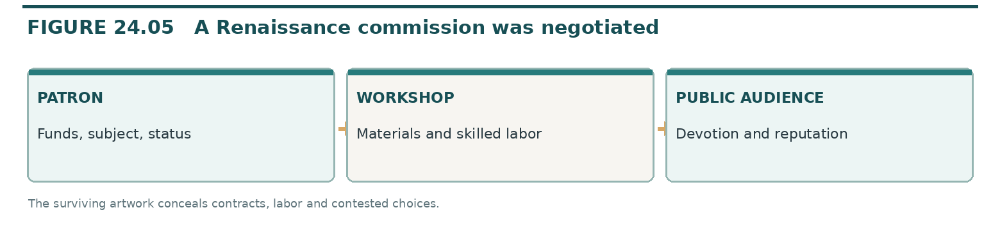

Ренесансовото изкуство процъфтявало чрез покровителство, връзка, в която отделни лица или институции плащали за предмети, изпълнения, сгради или научна работа. Един покровител може да бъде търговец, гилдия, епископ, религиозен ред, принц или гражданско правителство. Комисията може да установи материали, предмет, дата на доставка, разходи и очаквания за качество. Патроните често се интересували дълбоко от християнската преданост и спомена за членовете на семейството; други искали да покажат културна изтънченост или политическа сила. Художниците привеждат собствените си професионални амбиции, тренировки и практики в работилницата в сделката.

Шедьовърът често е бил колективен продукт. Учебници обучени чираци, подготвени повърхности, смесени цветове, издълбани рамки и понякога допринесоха обширно боядисани пасажи. Индивидуално приписване може да бъде сложно, когато майстор проектира работа, но асистенти изпълни голяма част от него. Оцеляването на договорите, счетоводните книги и техническите изпити помагат на историците да възстановят тези процеси. Нито пък творческата свобода е неограничена. Художниците могат да бъдат помолени да включват конкретни светци, разпознаваеми донори или скъп ултрамаринов пигмент. Преговорите за цената и престижа оформиха това, което зрителите в крайна сметка видяха.

Имаше обратна връзка. Успешните художници привличат богати покровители; видимите комисии засилват репутацията на покровителите; обучението и съперничеството насърчават техническите иновации; конкурентите търсят работа в съседните градове. Но имаше и риск. Политическото падение на един владетел би могло да прекъсне комисиите, докато една работилница може да се провали финансово, въпреки че произвежда отлично изкуство. Третирайте културното производство като пазар на труда, вграден в неравни социални институции, а не спонтанно изливане от лица, отделени от пари и власт. \[<a href="/024-renaissance-humanism-and-printing/sources/#source-5" class="cite">5</a>\]\[<a href="/024-renaissance-humanism-and-printing/sources/#source-7" class="cite">7</a>\]

<figure class="figure" id="figure-24-5">

<figcaption>Фигура 24.5. Оцелелите произведения на изкуството крият договори, труд и спорен избор. <a class="figure-anchor" href="#figure-24-5" aria-label="Link to this figure">#</a></figcaption>
</figure>
