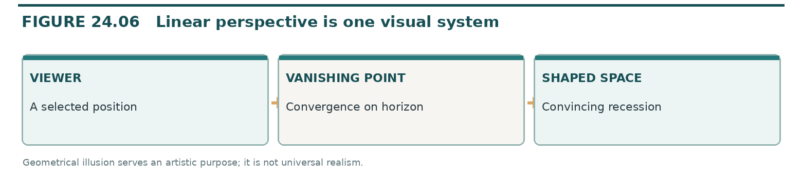

Едно от най-влиятелните събития в италианската ренесансова живопис е все по-систематичното използване на линейна перспектива. Обекти, представени колкото по-далеч могат да бъдат направени по-малки; паралелните линии, които се отдалечават в една изградена сцена, могат да бъдат организирани към изчезваща точка на хоризонта. Техниката не е изобретила наблюдението, че далечните неща изглеждат по-малки и никога не е било единственият начин артистите да представят пространството. По-ранни художници в различни общества са развили сложни пространствени конвенции. Характерното постижение на Ренесанса беше да формализира определени геометрични методи и да ги превърне във влиятелни учебни инструменти.

Художникът Masaccio в началото на петнадесети век фрески се празнуват за убеждаване телесно тегло и пространствена илюзия, докато Leon Battista Alberti's treatise върху живопис, съставен систематична рамка. Перспективата не е просто математическа декорация; тя е засегната, когато зрителят изглеждаше да стои по отношение на изображение. Успехът му зависи от гледната точка и артистичния избор. Една свещена сцена може да покани поклонниците да си представят разширение на самия параклис, или покровителят може да използва контролирана геометрия, за да предаде майсторство и ред.

Наблюдавайте две картини на града: едната използва схема на птичи очи, за да покаже всички важни сгради; другата показва улица от една въображаема позиция. Първият може да служи по-добре на ориентацията и символичната йерархия, докато вторият създава оптична консистенция. Обаждането на първото неточно предполага, че двете снимки имат една и съща цел. Перспективата е техника за конкретни представителни цели, а не универсална класация на художествените качества. Ценният навик е да се идентифицират правилата на изображението и да се запитаме какво те позволяват или крият. \[<a href="/024-renaissance-humanism-and-printing/sources/#source-13" class="cite">13</a>\]

<figure class="figure" id="figure-24-6">

<figcaption>Фигура 24.6. Геометричната илюзия служи на художествената цел; тя не е универсален реализъм. <a class="figure-anchor" href="#figure-24-6" aria-label="Link to this figure">#</a></figcaption>
</figure>
