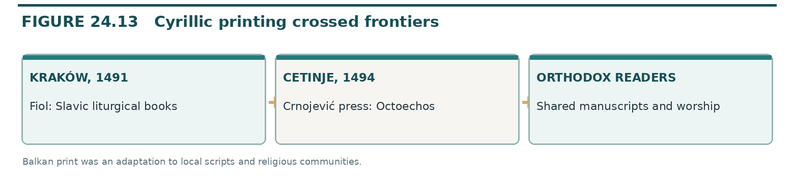

Латинският остава важен общ език на европейската стипендия, но печатните книги също се появяват на много езици. Читателите на италиански, немски, френски, английски, испански и други езици можели да се сблъскат с текстове, които не били ограничени само до високообразованите латино специалисти. Езикът на една книга оформи потенциалния си пазар и общностите, които биха могли да го претендират за свой собствен. Но езиковите граници били порести. Хората четат на глас други хора, превеждат пасажи и споделят устни обобщения. Книгата на езика не била автоматично книга за всеки.

Печатането също зависи от типа, подходящ за определени скриптове. Магазин за латинска азбука не може непременно да произвежда гръцки, еврейски или кирилица издания без нови шрифтове, опит и очаквани купувачи. Хуманистките принтери инвестираха в гръцки тип, а други работилници служеха на еврейски, православни християни и различни регионални общности. По този начин Типографията е история на идентичност и технически избор. Дизайнът на буквите, не само съдържанието на текстове, помага да се обясни защо някои пазари са се разширили преди други.

Ранният кирилски печат илюстрира една по-географско свързана история. Славният литургичен печат на Швайпол Фиол в Краков е свързан с 1491 г., през 1490-те години на ХХ век печатарската компания Crnojević в Цетине произвежда църковни славянски книги, включително Октоечос от 1494 г. Тези инициативи усложняват историята на печата между Италия и северозападна Европа. Религиозни общности, местни владетели, занаятчии и книги пресичат граници, които не съответстват на съвременните национални държави. За Балканите новата технология взаимодействаше с по-старите практики на ръкописа и православното поклонение, а не просто да ги замени. \[<a href="/024-renaissance-humanism-and-printing/sources/#source-30" class="cite">30</a>\]

<figure class="figure" id="figure-24-13">

<figcaption>Фигура 24.13. Балканският печат е бил адаптация към местните скриптове и религиозни общности. <a class="figure-anchor" href="#figure-24-13" aria-label="Link to this figure">#</a></figcaption>
</figure>
