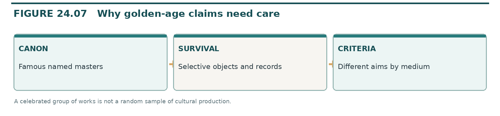

Художествени историци често използват High Renaissance за изключителни развития в Рим, Флоренция и свързаните с тях центрове около края на петнадесети и началото на шестнадесети век. Произведенията на Леонардо, скулптурата и живописта на Микеланджело, и композициите на Рафаел станаха тъчстоуни за по-късните поколения. Техните различни постижения не трябва да бъдат сплескани в една формула: работата на художника със светлината, ангажираността на скулптора с масата и проблемите с дизайна на архитекта изискват отделен анализ. Един период етикет помага да се организира сравнение, а не да се докаже обективен връх, че всеки художник преди или след не успя да достигне.

Художественото изкачване на Рим зависело много от папската покровителство. Папата действа като религиозни водачи и могъщи владетели с амбиции да трансформират града и неговите институции. Комисиите могат да изразят теологията, семейното положение и конкурентните претенции към всеобщия авторитет. Ватиканът се превърна в голям обект на културно производство, но парите, труда и политическите сделки зад работата също имаха значение. Хвалата на една художествена златна епоха не трябва да прикрива фискалния натиск и конфликтите на италианските войни или напрежението в Църквата.

Фразата Златна епоха често ни казва кои работи по-късно колекционери и училища са избрали да празнуват. Тя може да замъгли по-малко модерни медии като текстил, мебели, архитектура, градски фестивали или работа на жени и занаятчии. Това, което оцелява в музеите, не е случайна проба от всичко направено от хората. За оценка сравни посочените художествени критерии, социалния контекст и оцеляването на предметите. Трябва да признаем изключителните умения, без да се преструваме, че естетичната преценка е чисто механична мярка. \[<a href="/024-renaissance-humanism-and-printing/sources/#source-5" class="cite">5</a>\]\[<a href="/024-renaissance-humanism-and-printing/sources/#source-17" class="cite">17</a>\]

<figure class="figure" id="figure-24-7">

<figcaption>Фигура 24.7. Известната група произведения не е случайна извадка от културно производство. <a class="figure-anchor" href="#figure-24-7" aria-label="Link to this figure">#</a></figcaption>
</figure>
