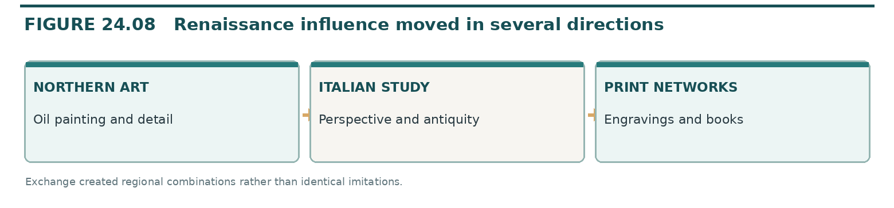

Ренесансовата културна промяна премина през Алпите чрез пътувания, търговия, династични домакинства, църковни мрежи и печатни книги. В ниските страни художници като Jan van Eyck и Rogier van der Weiden постигат поразителен оптичен детайл чрез сложна работа с пигменти и техники на маслената основа. Тези традиции не могат да бъдат сведени до италианска перспектива, пристигаща късно. Недърландските майстори разработиха свои собствени начини за представяне на текстура, отразяваща светлина и свещено присъствие, докато покровителите в северните градове и съдилища подкрепяха различни жанрове и работилници.

В немскоговорящите земи Албрехт Дюрер изучава италианските теории за пропорция и перспектива, докато се превръща в изключителен печатар. Неговите гравюри и дърворезби се разпространиха отвъд ограничения брой хора, които можеха да видят една картина. Това ни води до важна промяна: изображението може да се превърне в повтарящ се, търгуващ се обект. Печатарството има свои предишни истории, но разширяващият се му мащаб променя икономиката на визуалната култура. Авторство, копиране и художествена репутация поеха нови форми.

Северният хуманизъм поставял силен акцент и върху християнското обучение и реформите. Еразъм от Ротердам и други се стремиха към подобрения в образованието, езика и скриптуралното разбиране. Думата север не трябва да прикрива различията между Англия, немските територии, ниските страни, Франция и Иберия. Нито пък италианската култура трябва да бъде третирана като единствен източник на всичко ценно. Ренесансът е произведен чрез обмен между няколко регионални традиции, чиито техники, пазари и институции не са идентични. \[<a href="/024-renaissance-humanism-and-printing/sources/#source-20" class="cite">20</a>\]\[<a href="/024-renaissance-humanism-and-printing/sources/#source-21" class="cite">21</a>\]

<figure class="figure" id="figure-24-8">

<figcaption>Фигура 24.8. Обменът създава регионални комбинации, а не идентични имитации. <a class="figure-anchor" href="#figure-24-8" aria-label="Link to this figure">#</a></figcaption>
</figure>
