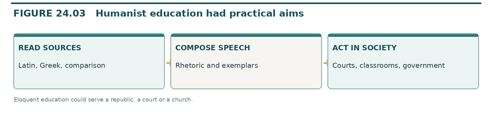

Студиата хуманитатис обикновено включва граматика, реторика, поезия, история и морална философия. Тя не трябва да се разбира като идентична с един модерен университетски хуманитарен отдел или като движение, което е измислило изучаването на човешките същества. Хуманистката цел била да се култивират читатели, способни да отличат добрия латински, да тълкуват исторически примери, да съставят аргументи и да говорят убедително в граждански и съдебни условия. Нарастващото внимание към гръцкия език разширило корпуса на древните произведения, достъпни за някои образовани италианци.

Един хуманистичен клас може да разгледа пасаж от Ливи не само за да преведе думите си, но и да попита как един римски лидер е убедил тълпата или защо една република отказала. Учениците копират образцови изречения, композират писма и практикуват речи. Обучението може да бъде взискателно, социално ексклузивно и силно ориентирано към елитни мъжки кариери. В същото време обучението създаде нови навици за близко сравнение между текстовете и по-голям пазар за надеждни издания. Учителите и секретарките носеха тези техники между градовете и съдилищата.

Трябва да различим идеала от доказателствата за резултатите. Обучението в Цицерон не гарантирало на един добродетелен политик; нито изучаването на гръцки направи някой имунизиран към предразсъдъците. Реториката може да осветява проблеми или да ги прикрие. Да разгледаме едно въображаемо дипломатическо писмо, което възхвалява един владетел като нов Август. Неговият класически речник ни разказва за обучението на писателя и политическия образ, който владетелят искал да проектира, а не дали владетелят всъщност управлявал като Август. Същото скептично четене, използвано в глава 1, трябва да се прилага за известни хуманистки източници. \[<a href="/024-renaissance-humanism-and-printing/sources/#source-2" class="cite">2</a>\]\[<a href="/024-renaissance-humanism-and-printing/sources/#source-8" class="cite">8</a>\]

<figure class="figure" id="figure-24-3">

<figcaption>Фигура 24.3. Красноречивото образование може да служи на република, съд или църква. <a class="figure-anchor" href="#figure-24-3" aria-label="Link to this figure">#</a></figcaption>
</figure>
