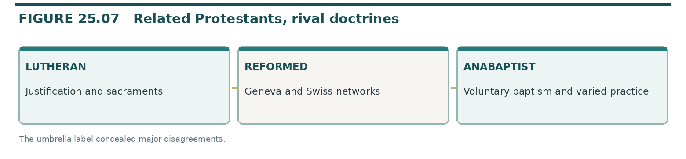

Джон Калвин, роден във Франция през 1509 г., станал един от най - влиятелните реформирани теолози. Неговите институти на християнската религия, публикувани за първи път през 1536 г. и многократно разширени, представи систематичен разказ за християнското учение. Кариерата на Калвин в Женева била политически сложна: той пристигнал в града през 1536 г., бил изключен през 1538 г. и се върнал през 1541 г. Реформата зависела от преговорите между пастори, магистрати, жители и институции, а не от всемогъщ теолог, лично командващ града.

Женева насърчавала структурираната служба, напътствията и моралната дисциплина. Неговият състав изследва поведението, брачните спорове и религиозната практика, като работи в рамките на граждански ред, чиято власт е била оспорена. Учението на Калвин за божествено провидение и предопределение станало влиятелно, но описването на системата на града просто като съвременна "теокрация" крие променящите се граници между съвета и духовенството. Екзекуцията на Майкъл Сервет за ерес през 1553 г. остава ясен пример за смъртоносна нетърпимост при протестантско гражданско управление. Тя не може да бъде отхвърлена като маловажна, защото други органи също преследваха дисиденти.

Женева се превърна в център за бежанци, принтери и министерско обучение. Реформираните мрежи достигат Франция, Холандия, Шотландия и части от Свещената Римска империя, като същевременно остават коренно разнообразни. Обръщението на духовенството и книгите било толкова важно, колкото и законите на един град. Влиянието на Калвин показва как един компактен интелектуален и институционален център може да има значителни последици, когато обучава хората, печата текстове и предлага убежище на мигрантите. То също така илюстрира моралното противоречие на настояването за реформа на съвестта, като използва публичната власт, за да потуши съперничещите религиозни убеждения. \[<a href="/025-reformation-and-religious-conflict/sources/#source-12" class="cite">12</a>\]\[<a href="/025-reformation-and-religious-conflict/sources/#source-13" class="cite">13</a>\]

<figure class="figure" id="figure-25-7">

<figcaption>Фигура 25.7. Етикетът на чадъра криеше големи разногласия. <a class="figure-anchor" href="#figure-25-7" aria-label="Link to this figure">#</a></figcaption>
</figure>
