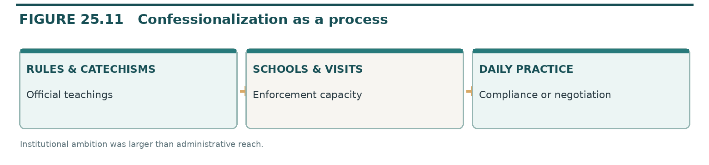

До края на шестнадесети век много владетели и църковни власти се опитали да организират териториите си около официално предпочитана изповед. Този процес понякога се нарича изповедализация: религиозните напътствия, регулирането на брака, образованието, проверката на духовенството, преброяването, църковните съдилища и моралната дисциплина могат да бъдат координирани с растежа на териториалното управление. Лютеранските, реформираните и католическите режими са разработили инструменти за надзор, въпреки че не в идентични форми или с еднаква ефективност.

Терминът е полезен, защото свързва религията с институциите, вместо да третира доктрината като набор от изолирани идеи. Ако правителството иска енорийските деца да познават катехизис, то се нуждае от училища или редовни напътствия; ако иска духовенството да спазва правилата, то се нуждае от посещения, записи и средства за изпълнение. Това създава административна дейност и нова информация за темите. И все пак историците не са съгласни за това колко тясно църкви и държави работят заедно, колко обикновени хора интернализират официалните вярвания и дали един европейски модел замъглява регионалните различия.

В архивите на един град може да се съобщава за кампания срещу публичното пиянство, неоторизирани празненства или присъствие в поклонението на друг изповед. Тези записи показват приоритетите на властите, а не непременно успешната реформа. Гражданите можеха да избягват правилата, да преговарят за изключения, да продължат по-старите ритуали насаме или да намерят местните служители симпатизиращи на техните практики. Сравнението наподобява мислене на системите: повече наблюдение може да увеличи съответствието, но също така може да доведе до устойчивост, прикриване и скъпо изпълнение. Изповедта е хипотеза за институционален модел, а не доказателство, че религията навсякъде е била механично контролирана от държавата. \[<a href="/025-reformation-and-religious-conflict/sources/#source-1" class="cite">1</a>\]\[<a href="/025-reformation-and-religious-conflict/sources/#source-2" class="cite">2</a>\]

<figure class="figure" id="figure-25-11">

<figcaption>Фигура 25.11. Институционалната амбиция беше по-голяма от административната. <a class="figure-anchor" href="#figure-25-11" aria-label="Link to this figure">#</a></figcaption>
</figure>
