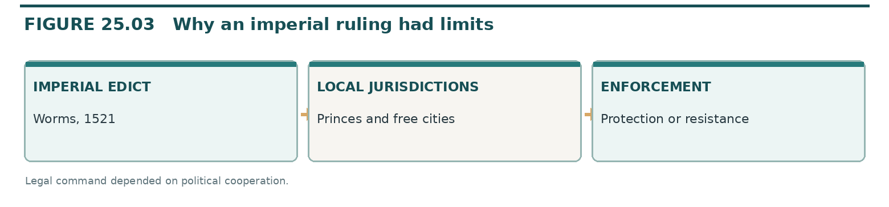

До 1519 г. споровете на Лутер с теолози като Йохан Ек повдигнаха фундаментални въпроси относно авторитета на папите, съветите и писанията. През 1520 г. публикува влиятелни писания за реформи, които нападат установените църковни структури и предлагат ревизирани разкази за християнската свобода и тайнствата. Бикът на папа Лео Х, Ексург Домин, заплашил с действия срещу предложения, приписвани на Лутер; Лутер публично отхвърлил папското осъждане. През 1521 г. е отлъчен. В Диета на Червеите, един императорски конгрес, той отказа да оттегли писанията, освен ако не бъде убеден от писание или убедителна причина, въпреки че известни драматични речи, свързани с тази сцена, имат несигурни думи.

Император Чарлз V се сблъскал с проблем, който не бил чисто религиозен. Неговите владения се простирали из цяла Европа и отвъд океана, и той се изправял пред съпернически сили, включително Франция и Османската империя. Германските принцове охранявали териториалните привилегии в Свещената Римска империя, комплексна колекция от княжества, църковни територии и градове. Фредерик Мъдрия от Саксония защитава Лутър след Червеите, позволявайки му да се подслони в замъка Уортбърг. Имперското осъждане не се превежда автоматично във всеки град и имение.

Това беше сблъсъкът на два кантара на правителството. Всеобщите религиозни претенции бяха защитавани от институции, които зависеха от териториалното сътрудничество. Заповедта на владетеля може да бъде авторитетна на хартия и невъзможна, където местните магистрати, принцове или общности се съпротивлявали. Изучаването на диетата на червеите заедно с императорската политическа география обяснява повече от представянето на Лутер като самотен герой, който победил обединен континент. Той беше смел да защитава вярванията си; оцеляването му също зависеше от държави, съюзи и институционални граници. \[<a href="/025-reformation-and-religious-conflict/sources/#source-1" class="cite">1</a>\]\[<a href="/025-reformation-and-religious-conflict/sources/#source-6" class="cite">6</a>\]\[<a href="/025-reformation-and-religious-conflict/sources/#source-7" class="cite">7</a>\]

<figure class="figure" id="figure-25-3">

<figcaption>Фигура 25.3. Правното командване зависи от политическото сътрудничество. <a class="figure-anchor" href="#figure-25-3" aria-label="Link to this figure">#</a></figcaption>
</figure>
