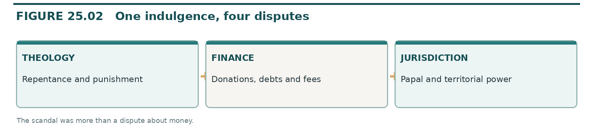

Конкретна кампания за снизхождение постави тези напрежения на фокус. В Светата Римска империя, Албрехт от Бранденбург проведе важни църковни служби, докато набирането на средства, свързани с възстановяването на Св. Петър в Рим създаде натиск за приходи. Доминиканският проповедник Йохан Тецел се свързва с промоция на индулгенцията в райони близо до Витенберг. Финансовите договорености били сложни и имали полза от повече от една институция; изобразявайки ги просто като един човек, който продава небето на наивни клиенти, крие машините за назначения, дългове, разрешения и проповядване.

Спорът е бил взривоопасен, защото е минал няколко граници едновременно. На богословско ниво, кой може да определи как е свързано покаянието и наказанието? На пасторално ниво дали на вярващите били дадени фалшиви уверения? На икономическо ниво, къде ще отидат събраните средства? На политическо ниво, може ли папска програма да работи през териториалните интереси на принцовете? Тези слоеве не винаги създават едни и същи съюзи. Един принц може да не харесва финансовите потоци към Рим, докато поддържа традиционното поклонение; един професор може да атакува небрежно проповядване, без да възнамерява да създаде нова църква.

По-широкият урок е, че спорната практика може да се превърне в символ на много по-голям аргумент. След като критиците свързали индулгенциите с авторитета на папската власт, отговорът на теологичните им възражения станал по-труден без обсъждане на институциите и властта. И все пак историците не трябва да се бърка това, което реформатор по-късно дойде да вярват с това, което той вече е решил през 1517. Първият спор на Лутер все още не бил пълен план за отделно протестантско вероизповедание. \[<a href="/025-reformation-and-religious-conflict/sources/#source-4" class="cite">4</a>\]\[<a href="/025-reformation-and-religious-conflict/sources/#source-5" class="cite">5</a>\]\[<a href="/025-reformation-and-religious-conflict/sources/#source-6" class="cite">6</a>\]

<figure class="figure" id="figure-25-2">

<figcaption>Фигура 25.2. Скандалът беше повече от спор за пари. <a class="figure-anchor" href="#figure-25-2" aria-label="Link to this figure">#</a></figcaption>
</figure>
