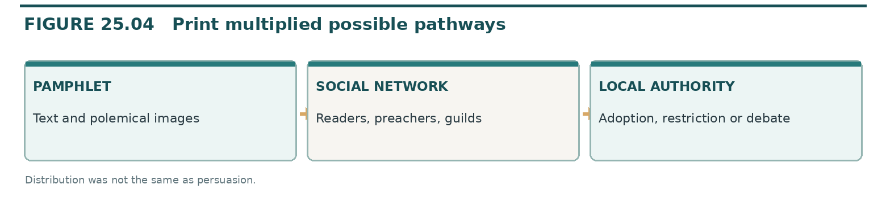

Ранната Реформация била медийно събитие, но това не означава, че всяко домакинство притежавало Библия или можело да чете. Принтерите произвеждали брошури, народни проповеди, песнопойки, катехизми и полемични изображения. Публичното четене и проповядването донесли текстове на хора, които ги срещали заедно. Уудкъти изобразени реформатори, папи, свещеници и противници на религиозни претенции в лесно разпознаваеми форми, понякога използвайки подигравки и плашещи стереотипи. Музиката носела аргументи в сборовете; текстове, разпространявани чрез търговци, ученици и пътешественици.

Тези мрежи също така създават ефекти на подбор. Най-добре запазените печатни произведения могат да ни разкажат повече за градските издателски пазари, отколкото за това какво мислят отдалечени села. Широко отпечатан трактат доказва наличието, а не съгласието. Броят на изданията е доказателство за търговско и политическо внимание, а не директно проучване на общественото мнение. Властите от различни страни издават заповеди за цензура и изземат публикации, докато принтерите се приспособяват към местното покровителство, опасност и печалба. Същата технология дава възможност за католически катехизми и анти-протестантски отговори.

Представете си три града, които получават една и съща брошура. В една от тях един симпатичен съвет спонсорира проповед; във втората властите забраняват обсъждането; в третата търговците четат брошурата, но остават предпазливи относно промяната на поклонението. Идентичният печатен текст има три различни институционални резултата. Медиите разпространяват възможности, а не автоматични последствия. Това разграничение ще се върне в по-късни глави за вестници, пропаганда и съвременни социални платформи. \[<a href="/025-reformation-and-religious-conflict/sources/#source-1" class="cite">1</a>\]\[<a href="/025-reformation-and-religious-conflict/sources/#source-4" class="cite">4</a>\]\[<a href="/025-reformation-and-religious-conflict/sources/#source-8" class="cite">8</a>\]

<figure class="figure" id="figure-25-4">

<figcaption>Фигура 25.4. Разпределението не било същото като убеждаването. <a class="figure-anchor" href="#figure-25-4" aria-label="Link to this figure">#</a></figcaption>
</figure>
