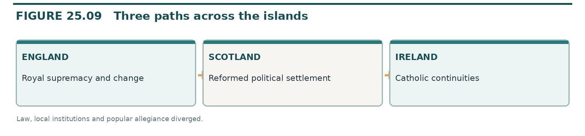

В Шотландия религиозната реформа се развивала по международните мрежи, местната благородна политика и проповедната дейност, свързана с Джон Нокс. Шотландският парламент на Реформацията от 1560 г. помогна за установяването на протестантско споразумение, макар че отношенията между короната, църквата и парламента останаха неуредени. Реформираната теология повлияла на организацията на Кърка, включително и по-късните презвитериански традиции. Шотландските събития са свързани с борби над Мери, кралицата на Шотландия, отношенията с Англия и Франция, както и баланса между аристократичните фракции и царската власт.

Ирландия представя различна история. Английското управление било неравномерно и опитите за създаване на протестантска църква като цяло не спечелили предаността на голямото мнозинство от говорещите ирландци, които продължили католическата практика. Собственост на земята, политическа лоялност, език и завоевание се преплитат с изповедлна идентичност. По-късно плантациите и принудителните държавни политики засилиха тези разделения. Не бива да допускаме английско правно споразумение, което автоматично определя религиозния живот на островите. Местните свещеници, семейства, институции и трансгранични контакти често са били по-важни от указите, издадени в Лондон.

Тези контрасти разкриват важна историческа разлика: владетелят може да създаде правна църква, без да преобразува населението. Трайната изповедна идентичност се появява от поколение след поколение институции, социален натиск, памет на общността и политически събития. Нито "протестант" или "католик" съответства на непроменяща се национална личност. Признаващата принадлежност може да се пресича с политическа вярност, докато се развива чрез конфликти и компромиси. \[<a href="/025-reformation-and-religious-conflict/sources/#source-2" class="cite">2</a>\]\[<a href="/025-reformation-and-religious-conflict/sources/#source-14" class="cite">14</a>\]

<figure class="figure" id="figure-25-9">

<figcaption>Фигура 25.9. Закон, местни институции и популярна вярност се различават. <a class="figure-anchor" href="#figure-25-9" aria-label="Link to this figure">#</a></figcaption>
</figure>
