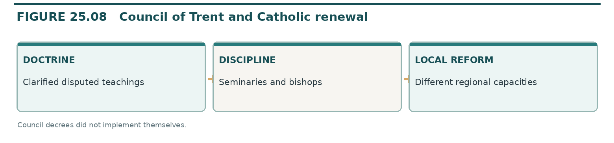

Съветът на Трент заседава в три основни периода между 1545 и 1563 г., прекъсвани от война, болести, политика и разногласия относно църковната власт. Неговите участници бяха католически прелати и теолози, а не среща, в която протестантски и католически делегати преговаряха за общ компромис. Съветът изясни спорните доктрини, включително писанията и традициите, оправданието и тайнствата и потвърди основните черти на католическото поклонение. Той също така прие дисциплинарни реформи, насочени към образованието на духовенството, пасторалния надзор и епископските отговорности.

Подвеждащо е да се опише Трент като просто забрана на промените. Съветът запази доктрините, които са от основно значение за католическата идентичност, като същевременно създаде рамки за институционалната промяна. Семинарите станали важни за обучението на свещениците, макар че изпълнението им се различавало сред епархите. Литургичните книги и катехизиите, издадени или ревизирани през следващите години, помогнали за стандартизиране на аспектите на поклонението. Решенията на съвета не заличиха мигновено по-старите практики или не произведоха идентични католически общности от Лисабон до Краков. Местната политика, финансирането и пасторалните навици продължиха да имат значение.

Трент също показва защо теологичното несъгласие може да се втвърди до трайно институционално разделение. Католиците и протестантските водачи все повече обяснявали традициите си с по - точни думи. Тази интелектуална яснота може да засили образованието и вътрешната съгласуваност, като същевременно направи компромиса по-труден. В ретроспекция историците спорят дали "конфесионализацията" описва координирана система на държавно и църковно възпитание или преувеличава това, което ранните модерни правителства биха могли да контролират. Документалният запис подкрепя както стремежа към по-голямо регулиране, така и значителни пропуски между официалната рецепта и обикновения живот. \[<a href="/025-reformation-and-religious-conflict/sources/#source-17" class="cite">17</a>\]\[<a href="/025-reformation-and-religious-conflict/sources/#source-18" class="cite">18</a>\]

<figure class="figure" id="figure-25-8">

<figcaption>Фигура 25.8. Указите на Съвета не се изпълниха сами. <a class="figure-anchor" href="#figure-25-8" aria-label="Link to this figure">#</a></figcaption>
</figure>
