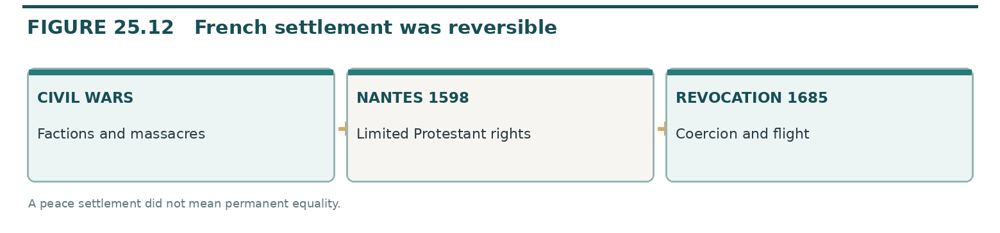

Във Франция реформатори протестанти, известни като хугеноти, се присъединили сред някои благородници, жители на града и други групи. Напрежението се преплиташе с властта на монархията, аристократичните фракции, местните съперници и страховете за бъдещето на Царството. Поредица от граждански войни започнали през 1562 г., но конфликтите не следвали прост модел на две фиксирани армии, които воювали непрекъснато. Съдилищата договорили примирие, религиозните партии се разделили и местното насилие можело да продължи дори след официално споразумение.

Кланетата в Деня на Свети Вартоломей започват в Париж през август 1572 г., последвани от насилие в няколко провинциални града, убили хиляди протестанти. Броят остава дебатиран и се различава между оценките; историците изследват взаимодействието на царските решения, фактологичната политика, популярната враждебност и събитията, които са ескалирали отвъд първоначалните планове. Това не било просто жалко недоразумение между абстрактните доктрини. Хората бяха нападнати и убити, защото религиозната идентичност се беше превърнала в маркер за колективна заплаха в нестабилна политическа обстановка.

Хенри от Навар, в крайна сметка Хенри IV от Франция, се превърнал в католицизъм и осигурил царуването си на фона на конфликта. Неговият едикт на Нант през 1598 г. дава важни, определени права и защити на френските протестанти, като същевременно запазва привилегированата позиция на католицизма; той не създава съвременно универсално равенство. През 1685 г. Луи XIV отменя указа, предизвиквайки подновени репресии и протестантски полети. Епизодът показва защо едно мирно споразумение не гарантира постоянна толерантност. Правните селища зависят от политическите институции и готовността на по-късните владетели да ги поддържат. \[<a href="/025-reformation-and-religious-conflict/sources/#source-24" class="cite">24</a>\]\[<a href="/025-reformation-and-religious-conflict/sources/#source-25" class="cite">25</a>\]

<figure class="figure" id="figure-25-12">

<figcaption>Фигура 25.12. Мирното споразумение не означава постоянно равенство. <a class="figure-anchor" href="#figure-25-12" aria-label="Link to this figure">#</a></figcaption>
</figure>
