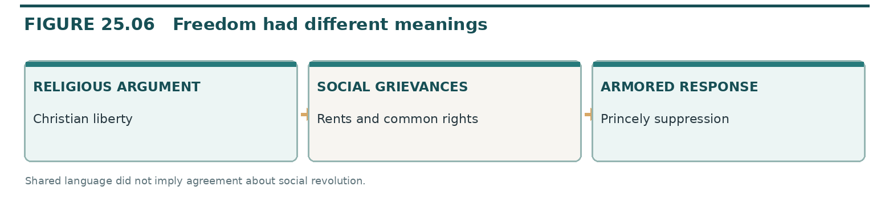

През 1524 и 25 г. въстания в различни части на немскоговорящите земи събраха селяни и някои жители, които настояват за промени в дължимите суми, достъп до общи ресурси, правосъдие и местна власт. Дванадесетте статии, свързани с бунтовниците в горната част на Суабия, се позовавали на библейски стихове и твърдения за справедливост. Скръбта не била идентична навсякъде, нито била създадена изключително чрез проповядването на Лутер. Дълги спорове за господство, наеми и обичайните права предоставят незабавната обстановка. Но един религиозен език на християнската свобода дал някои изисквания за допълнителна сила.

Първоначално Лутер подканил вниманието към оплакванията, но строго осъдил въоръжения бунт, особено когато насилието се разпространило. Неговите писания срещу непокорните селяни насърчили властите да попречат на бунта, а князските сили убили много хора. Приблизителните оценки на смъртните случаи варират, защото съвременните показатели са неравни, но поражението е опустошително. Други религиозни водачи заемали различни позиции. Томас Мюнцер се свързва с радикални аргументи и готовност да оспори установените владетели; ролята му не трябва да бъде опростена в съвременна светска революция, маскирана като религия.

Опитът на селяните разкрива пропастта между мощна религиозна метафора и програма за социална реформа. Свободата на един християнин може да означава освобождение от бремето на спечелването на спасение, но хората, които живеят под власт, могат да чуят по - широко обещание. Лидерите на реформите не се съгласиха, че теологичната свобода оправдава обръщането на социалните йерархии. Дали въстанието било причинено от Реформацията? Основаният на доказателства отговор отличава дългогодишните икономически и политически причини от новия език, съюзи и очаквания, които оформят събитията. Религиозните движения могат да генерират значения, които първоначалните им водачи не могат да контролират. \[<a href="/025-reformation-and-religious-conflict/sources/#source-1" class="cite">1</a>\]\[<a href="/025-reformation-and-religious-conflict/sources/#source-2" class="cite">2</a>\]\[<a href="/025-reformation-and-religious-conflict/sources/#source-3" class="cite">3</a>\]

<figure class="figure" id="figure-25-6">

<figcaption>Фигура 25.6. Споделеният език не означава съгласие за социална революция. <a class="figure-anchor" href="#figure-25-6" aria-label="Link to this figure">#</a></figcaption>
</figure>
