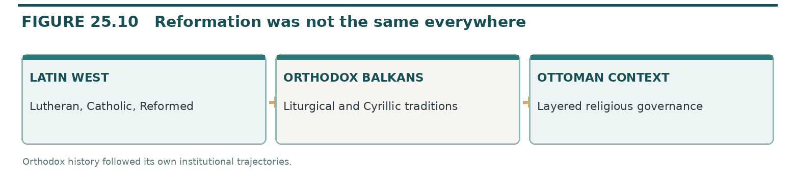

Протестантската реформация до голяма степен се развивала в рамките на латинското християнство. Повечето православни общности на Балканите го изпитаха от различна политическа и богословска обстановка. След османските завоевания православните религиозни институции продължиха под мюсюлманското императорско управление, но техните позиции, привилегии и фискални задължения се промениха чрез преговори, конфликти и местна практика. Учените предупреждават да не се описва империята от петнадесети и шестнадесети век, сякаш напълно фиксирана просо система от деветнадесети век вече съществува навсякъде. Вселенската патриаршия, регионалните църкви, манастирите и местните водачи не всички притежават една и съща власт.

Следователно за българските страни историята не е проста последователност от лутерански доктрини, които изместват православното християнство. Манастири и духовници запазили литургическите и ръкописни традиции, докато православните славянски текстове се разпространявали чрез печатни центрове извън и в рамките на османските юрисдикции. Ранният печат на кирилица и сръбски език в региона, включително пресите, свързани с Цетине и други православни центрове, показва, че технологичната дифузия не изисква доктринално изравняване с Витенберг. Печатането служило на православната литургия, ученето и идентичността, както и на западните изповеднически дебати.

Османската империя също оформя европейските геополитически изчисления. Чарлз V, Хабсбургите и други сили са се сблъсквали с османски кампании, докато религиозни разделени християнски владетели понякога са били координирани срещу тях и в други случаи са се състезавали въпреки външна заплаха. Православните общности не трябва да се появяват като пасивни наблюдатели или като ранни съвременни "Протестанти под прикритие." Религиозната им история следва своите собствени аргументи, институции, срещи и ограничения. Тази по-голяма перспектива коригира друго западноевропейско определение на шестнадесети век. \[<a href="/025-reformation-and-religious-conflict/sources/#source-28" class="cite">28</a>\]\[<a href="/025-reformation-and-religious-conflict/sources/#source-29" class="cite">29</a>\]

<figure class="figure" id="figure-25-10">

<figcaption>Фигура 25.10. Православната история следва собствени институционални траектории. <a class="figure-anchor" href="#figure-25-10" aria-label="Link to this figure">#</a></figcaption>
</figure>
