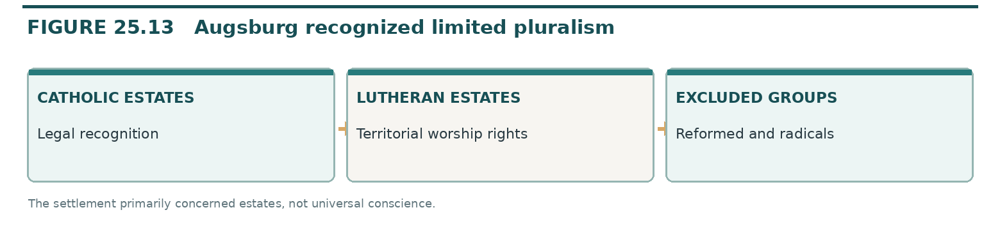

В рамките на Свещената Римска империя протестантските принцове и градове формирали Шмалдската лига, за да защитят интересите си. Чарлз V в крайна сметка победил лигата военно през 1547 г., но победата не осигурила трайно възстановяване на католическото единство. Възобновяването на съюзи и войни ограничава имперската власт. Религиозният мир в Аугсбург, приет през 1555 г., признава законно съвместно съществуване на католически и лютерански териториални договорености в рамките на империята при определени условия.

Познатият shorthand cuius regio, Eius regligio. "чийто правило, неговата религия" е по-късна формула, отколкото пълен цитат от първоначалното споразумение. Той улавя принципа, че много имперски имоти могат да регулират официалната религия на своите територии, но прикрива изключения, права на емиграция, специални договорености в някои градове и изключването на реформираните/калвинистите и анабаптистите общности от пълно признаване. Аугсбург не бил харта за всеки човек да вярва и да се покланя, както му било угодно. Това беше политическо споразумение между упълномощени владетели и имоти, предназначени да намалят конфликта.

Въпреки това споразумението било важно, защото то приемало правно структурирано религиозно разделение, което по - ранните власти се борели да признаят. Той не премахна необходимостта от преговори за църковна собственост или юрисдикция, а по-късно споровете разкриха ограниченията му. Сравнението със съвременната свобода на религията трябва да започне с въпроса кой притежава юридическа власт. Аугсбург до голяма степен защитава политическите имоти и определени определени общности; съвременните рамки на правата като цяло признават лицата за притежатели на права. Историческите институции следва да бъдат оценени при свои собствени условия преди предявяването на претенции за непрекъснатост. \[<a href="/025-reformation-and-religious-conflict/sources/#source-20" class="cite">20</a>\]\[<a href="/025-reformation-and-religious-conflict/sources/#source-1" class="cite">1</a>\]

<figure class="figure" id="figure-25-13">

<figcaption>Фигура 25.13. Заселването засяга предимно имотите, а не универсалната съвест. <a class="figure-anchor" href="#figure-25-13" aria-label="Link to this figure">#</a></figcaption>
</figure>
